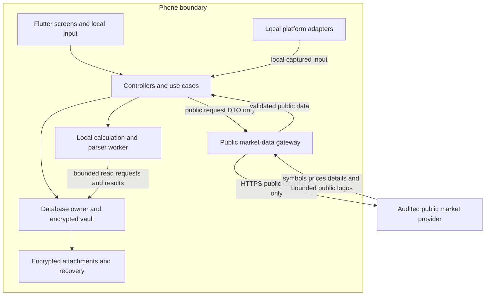

# Contour system design

Source: `docs/approved-architecture/SYSTEM_DESIGN.md`. Edit the source, then run `python3 -I tool/build_handoff.py`.

Version 1.8 · 16 October 2026 · ARCH-FINAL-001 technical baseline.

Contour is one app on one phone. An encrypted database holds the records. Local workers parse, calculate and prepare chart data. The interface reads small, shared versioned results. A restricted gateway fetches public symbols, prices, instrument details and approved public logos; it cannot upload financial records. Work is proportional to changed records or the visible view, never the whole history per chart or every account per price update. Performance targets are acceptance requirements; no benchmark has passed yet.

Ownership: SPEC financial meaning and release scope; this file module, storage and execution contracts; DESIGN visuals. Also read AGENTS, usage flows, DATABASE_DESIGN and the performance plan. Financial gates stay in force; architecture never infers a missing formula. Wealthfolio is out of scope.

## 1 Architecture decisions

| ID | DECISION | CONSEQUENCE |
|----|----------|------------|
| A01 | One local Flutter app with internal modules | No backend, login, hosted jobs, analytics, remote inference or sync |
| A02 | Drift, one encrypted SQLite vault, verified SQLCipher | Atomic linked writes; pinned, proven cipher build; no plaintext fallback |
| A03 | One writer owns confirmed mutations | Operation IDs and row revisions, not timestamps, resolve conflicts |
| A04 | Current records, financial event groups, ChangeLog | No full replay at open; ChangeLog is local audit/Undo, not a sync queue |
| A05 | Exact shared metrics and rebuildable persisted projections | One canonical value per scope/period/method; ordinary source and small-result changes publish atomically |
| A06 | One persistent CPU worker initially | Parsing, calculation and chart reduction off the UI thread |
| A07 | Exact values, separate drawing coordinates | Integer money, Decimal, checked kernel; only drawing coordinates are floating point |
| A08 | Bounded chart series and paged lists | Work depends on viewport or page size; exact tables stay available |
| A09 | One public market-data gateway, off by default | Typed symbols/prices/details and approved public logo requests; no remote FX, email, arbitrary URLs or exports |
| A10 | Same-device recovery with complete generations | Database and attachments switch together; no cloud, external file, LAN or merge |
| A11 | Local platform adapters, verified dependencies | No telemetry, cloud fallback or model downloads; typed/local-file input always works |
| A12 | Device benchmarks and fault injection before release | A fast cache hit is not evidence |
| A13 | Independent registry widgets from v1 Phase 1 | Generic surface host, isolated placement state and shared canonical metrics; no later conversion from fixed cards |

Workload tiers (synthetic test sizes, not supported limits): 50,000, 250,000 and 1,000,000 payments; 100,000, 1,000,000 and 5,000,000 public quote rows. Store no dense account × instrument × date matrix.

## 2 Trust and data boundaries



- The transport gets no database handle, attachment path, private record or arbitrary URL.
- Isolates are not an OS sandbox. Static boundaries, dependency review and device traffic tests enforce the network contract together.
- The provider sees IP, requested public symbols/asset IDs, timing and the provider credential. Requests can reveal investment interest; do not claim anonymous access.
- Account names, quantities, values, ownership, cost basis, transaction dates, files, transcripts and database IDs never enter the request schema.
- No outbound file export, encrypted or not. Recovery copies stay private; they do not cover phone loss, app removal or device-key loss.
- A local document can enter the app. The importer never follows a URL or exposes a cloud document.

## 3 Modules and interfaces

| MODULE | OWNS | MAY CALL | MUST NOT DO |
|--------|------|----------|-------------|
| lib/app/ | Composition, routing, unlock, lifecycle, worker startup | Application services, platform interfaces | Financial formulas, network transport |
| lib/features/ | Screens, immutable providers, controllers | Use cases, read repositories | SQL, parsers, native packages, styles, historical calculations |
| lib/domain/ | Entities, commands, invariants, exact math, parsers, return engine | Pure core types, abstract ports | Flutter, sockets, files, platform plugins, wall clock |
| lib/core/ | Money, Decimal policy, dates, state, IDs, errors | Pure libraries | Implicit time, financial display, binary money arithmetic |
| lib/data/db/ | Tables, indexes, migrations, transactions, revision metadata | Cipher adapter | Unreviewed connection creation |
| lib/data/repositories/ | Command execution, bounded read models | Database owner, domain functions | Exposing Drift rows or handles to features |
| lib/data/projections/ | Dirty ranges, generation staging and publication | Repositories, computation worker | Changing source facts; calling stale data current |
| lib/data/jobs/ | Durable local jobs, priority, leases, retries | Approved adapters, worker ports | Remote queues, unbounded in-memory work |
| lib/data/capture/ | Local staging, permissions, engine adapters | Native interfaces, pure parsers | Remote OCR, mail, model downloads, confirmed postings |
| lib/data/prices/ | Restricted gateway, provider adapters, response validation | One audited HTTP transport | Accessing user records, arbitrary request bodies |
| lib/data/backup/ | Private recovery generations, install journal, cleanup | Cipher, key, local-file interfaces | External folder selection, share sheet, sync |
| lib/design/ | Formatting, templates, charts, table, accessibility | Immutable presentation data | Database reads, financial calculations |

- Contract names (future code): CommandRepository.execute, ReadRepository.page, ProjectionRepository.read, LocalJobScheduler, CapturePort, KeyStore, ProtectedFiles, MarketDataGateway.
- Implementation types are module-private. Native callbacks enter through adapters, never raw into widgets.
- Read request: scope, date range, currency, filters, sort, cursor, limit. Response: rows/result, source revisions, availability, coverage, next cursor.
- Command: operation ID, expected entity revisions, typed arguments.
- Failures are typed, with message keys and safe field references; no file contents or values.

### 3.1 In-app widgets from Phase 1

WIDGET_FRAMEWORK implements the technical contract for SPEC W1–W13. App composition owns a compiled widget/tile registry, the bundled default layout file (validated at build time and compiled into the read-only app bundle as a constant; never read from a writable path, import or snapshot) and a generic two-level surface host (sections, then placements sized `full` or `half`). A release changes screen structure by changing that file, never screen code; no layout arrives over the network. Each feature owns one independent module per stable catalogue key. The screen supplies surface identity, fixed hero and template context; it has no widget-specific branches. The same bundle's closed add block defines the size, introduction version and insertion target of every library-only or cross-surface addition; the registry gives allowed sizes only. Design owns the slot, editor chrome, failure presentation and painters.

Placement state uses stable surface/item identity; financial requests use canonical metric identity without placement or host filters. A movable widget retains its own SPEC-defined scope, period, words and destinations. Section moves and half/full reflow cannot recreate surviving placement controllers or leases; the surface owns them independently of section/row subtrees. SCREEN-SET-001 state variants share one canonical surface. Sibling modules cannot read each other's controllers. Shared source changes and global presentation settings still update all relevant consumers.

Activation leases release every hidden, gated or inactive placement's subscriptions, timers, animations and geometry. Quick look parent removal releases its child placements; other live placements retain their shared metric references. Central availability metadata supports automatic empty-state appearance without mounting hidden modules. Source validation and required shared-summary maintenance continue independently of visibility.

Add widget uses a separate resident-only (cache-only peek) observation interface and pure inert preview builders. It acquires no normal lease and starts no query, refresh, calculation, timer, file load or network request; a cache miss shows the "Not loaded yet" preview state, never zero or a sample. Preview lifetimes, masking and memory bounds are specified in WIDGET_FRAMEWORK 3.1.

Slot failures do not join into a screen-wide failure. Phase 1 proves typed provider/callback failure handling plus descendant build/layout/paint fallback under one app-owned safe error policy. No raw diagnostic output or per-slot mutation of global Flutter handlers. Native OS widget policy stays launch-only.

The editor holds one private, bounded nested candidate. Done commits all touched surfaces together; Cancel and Undo write nothing. Home Default includes Quick look tiles. Per-surface owner counters and baseline descriptors prevent stale preference writes without conflicts from price updates. Unknown/unreleased/unsupported-size entries survive ordinary edits, including when their parent section loses its last visible child. Unknown section titles do not change the stored identity or prevent edits to known children. SPEC W13's LAYOUT-UPGRADE behavior remains product-gated; the reference model supports its preferred policy without approving it. Exact storage and uncertain-response handling: DATABASE_DESIGN 5.1.

## 4 Execution and scheduling

- SQL runs in a persistent database-owner isolate. One persistent computation worker runs pure-Dart parsing, exact calculations and chart reduction. Native OCR/camera follows its adapter's threading contract.
- Use bounded messages and transfer buffers, not repeated worker creation. Flutter isolates

| RESOURCE | INITIAL BOUND | AT THE BOUND |
|----------|---------------|--------------|
| Database writer | One connection, one command transaction | Priority queue; never open a second writer |
| Pending write commands | 32 commands or 8 MiB of arguments | Keep the draft, apply backpressure; large jobs refer to staged IDs |
| Heavy CPU work | One running job | Save validation and visible calculations outrank imports and maintenance |
| Parser output | 500 rows or 1 MiB per chunk; two unacknowledged chunks | Pause until the writer acknowledges staging |
| Normal list | 100 rows/page; max five active pages | Drop off-screen pages; keyset-load the next |
| Search | 50 results/page, bounded query, 150 ms debounce | Cancel superseded work; ignore late results |
| Application result cache | 32 MiB for exact results and drawing data | LRU eviction, off-screen first |
| Market requests | Two in flight; max 50 symbols per latest-price batch | Coalesce duplicates; apply provider limits |
| Active file import | One job | Others stay durable descriptors, not loaded buffers |

These are starting limits, tuned by the performance plan, in runtime configuration (not design tokens).

- The worker runs resumable slices. At each quantum (initially 10 ms) it checks cancellation, saves a checkpoint and returns to the scheduler, which can admit higher-priority work. Event-loop yield is not preemption. Measure real latency.
- Data-supplied rules and parser patterns use the bounded non-backtracking port in EXECUTION_SAFETY 3. Synchronous backtracking regex, an unbounded ruleset and timeout-only cancellation cannot satisfy this scheduler contract.
- Native decode needs its own pixel/page/time cap, admission check and cancellation; a Dart cancel cannot interrupt a synchronous native call.
- Reads use the owner first. A second read-only connection needs benchmark evidence, bounded snapshot lifetime, owner-issued invalidations and dbEpoch checks. Separate Drift objects do not synchronise watched queries. Drift isolates
- Priority, high to low: confirmed user command and active-page read; visible calculation; import preparation; quote ingestion; maintenance/rebuild. Reserve queue capacity for foreground commands.
- A second CPU worker is a measured optimisation only.
- Jobs resume after unlock. No correctness rule depends on a daily OS callback. Android work constraints

## 5 Storage and data ownership

### 5.1 One encrypted vault

- One database holds authoritative records, source identities, drafts, Inbox staging, job metadata, search and projections. Attachments are encrypted files referenced by its manifest. Each generation has its own directory.
- No user data in preferences, plain JSON caches, filenames or external storage.
- SQLCipher with a pinned native build and verified FFI binding on both platforms. Drift's simple encryption uses SQLite3MultipleCiphers, not SQLCipher; do not rely on sqlcipher_flutter_libs. Prove the build before app data exists. An engine change needs an architecture decision. Drift encryption
- Every open: apply the key before schema access, verify the cipher version in release code, read an authenticated page. Fail closed on missing cipher, wrong key or integrity failure. Never recreate a populated vault as empty.
- Memory-only temporary storage is mandatory. SQLCipher design
- Verify foreign keys and recursive triggers on at every open, WAL, synchronous=FULL, bounded busy timeout, measured page-cache budget, short transactions, passive idle checkpoints. Protected identities and replacement restrictions: EXECUTION_SAFETY 6.
- Monitor WAL size; pause background ingestion when long readers block reclamation. Never weaken durability for a benchmark without a new decision. SQLite WAL

### 5.2 Record classes

| CLASS | EXAMPLES | METADATA AND HISTORY | RETENTION |
|-------|----------|----------------------|-----------|
| Authored financial records | Account, Transaction, FinancialEvent, investment event, manual quote, balance/position observation, schedule, policy, goal | UUID v7, created/updated/deleted times, revision, ChangeLog per confirmed mutation | Never automatic; soft delete except explicit delete-all |
| Authoritative history | ChangeLog, OperationReceipt, SourceIdentity, CloseRevision, evidence of a saved revision | Immutable identity/version or compensating entry; ChangeLog never logs itself | While a dependent record/history/retry exists |
| Drafts and Inbox | Versioned draft, staged parsed rows, batch decisions | Local IDs, version status, operation link; no raw source text | Until Save/Discard; no automatic expiry |
| Derived data | Summaries, position checkpoints, return segments, FTS, chart buckets | Natural/composite keys, input revision, algorithm version, coverage | Rebuildable; quota and LRU; no Undo entries |
| Downloaded public inputs | Catalogue, provider quotes/details | Provider identity, timestamp, exact precision, basis, content revision | Quota; pin observations retained history needs |
| Retained public history | Acquired daily quotes/corrections for confirmed investment history and benchmarks; required detail versions | Independent immutable history pins; no duplicate price rows | No automatic expiry; independent of disposable generations |
| Public assets and layout | Audited raster logo cache; item and section keys, order and sizes | File references or local preferences; no financial ChangeLog | 16 MiB disposable logo budget; explicit layout reset |
| Operational data | Job leases, dirty ranges, import progress, install journal; retained Expected occurrences/locators | Natural/job keys, epoch, state | Until completion/recovery no longer needs them |

- UUID/timestamp/soft-delete and ChangeLog apply to authored domain tables only (including manual quotes, metadata edits, immutable occurrence decisions). FTS/cache refreshes write no history.
- Automatic occurrence generation maintains only undecided Expected proposals, without ChangeLog. A selected authored decision overlays or suppresses a proposal; typed obligation/settlement links prevent duplicate forecast entries (DATABASE_DESIGN 4.3). Identities and locators survive rule edits.
- A retained forecast freezes consumed proposals in projection_occurrence_inputs and pins its schedule and selected-decision after-images. Historical replay never rereads current proposals or selected pointers.
- A quote that a saved close or historical result references is immutable evidence; never evict it silently. Independent history pins also retain relevant acquired daily observations after all derived results are evicted. SHARED_STATE 4 defines original-file retention; blanket raw-file retention is not enabled.
- Drafts: structured fields; own ID, form type, schema version, referenced-entity revisions; no expiry. Resume never overwrites another draft. Save clears it in the confirmed transaction; Discard deletes payload and temporary material. Migration keeps it or shows an unsupported state. Restore invalidates old-generation drafts.

### 5.3 Financial event graph

Transaction is the canonical cash/account posting; never add a second cash ledger. The event group gives linked effects one atomic identity; it does not change income/spending rules. Domain validation checks the graph before commit.

| RECORD | KEY CONTRACT |
|--------|--------------|
| FinancialEvent | Type, effective date, operation ID, revision; links every economic effect |
| OperationReceipt | Unique operation ID, command type/payload digest, result IDs, revision; no duplicate mutation on retry |
| SourceIdentity | Unique non-null namespace + source account scope + record/row identity; content hashes are not uniqueness proof |
| BalanceAnchor | Immutable inclusive dated observation and evidence; balance = anchor plus later accepted postings (G01) |
| PositionObservation | Dated quantity/value evidence; no invented trade/cost history |
| ScheduledOccurrence | Stable nominal identity across rule edits, captured rule revision; Expected until confirmed/matched; one-offs have own identity |
| SettlementAllocation | Accepted posting → obligation and amount; partial payment without double counting |
| LotAllocation | Automatic cost-method output in a projection generation; lots/disposals are authored; saved close copies needed outputs |
| CloseRevision | Month, sequence, cutoff, input revision, method version, coverage, previous revision ID |
| DependencyRevision | Monotonic version per account/security/schedule/source scope |
| DirtyRange | Coalesced scope, earliest date, end boundary, required version |
| ProjectionGeneration | Staged/published status, input revisions, calculation version, bounded output, coverage |
| AttachmentManifest | Opaque file ID, linked record, encrypted path, authenticated size/hash, key reference |

- Transfer: two principal postings; documented fees link once. Reinvestment: one income event plus one acquisition, no external deposit. Vest/payslip: linked cash/security/tax effects, reusing a matched deposit.
- FIFO/average allocations, gains and checkpoints are derived. Source commits mark them dirty; workers publish a coherent replacement and never rewrite acquisition/disposal facts.
- Undo checks authoritative downstream events or a verified current result; an empty/stale cache proves nothing.
- G01 – G03 / G09 / G13 / G14 define the accounting rules and fixtures required before those commands ship.

### 5.4 Index and query contracts

- DATABASE_DESIGN and QUERY_CONTRACTS hold tables, indexes and executable queries. Contract: authored UUIDs, compact market keys, non-null source identities, keyset paging, split contributions, complete local FTS, exact quote evidence.
- SCHEMA.sql is a tested structural reference, not a production migration. Daily quote tables do not claim intraday support.
- Bounded candidate extraction and a cancellable residual-filter path stop LIMIT hiding an unbounded scan. Validate plans on populated fixtures, then on the pinned encrypted device build.

## 6 Commands consistency and Undo

1. Persist an operation ID with the structured draft before submission; freeze command and payload digest. Duplicate-tap suppression is not a correctness mechanism.
2. Check the receipt first. A committed retry returns its recorded outcome; a reused ID with different arguments fails. Large outcomes refer to a batch ID.
3. Prepare expensive validation (in the worker if needed) outside the write transaction from revisioned inputs. The writer rechecks revisions and all invariants before applying the plan.
4. In one transaction write linked records, source links, attachment references, ChangeLog, revisions/dirty ranges, receipt and draft completion. An ordinary bounded edit also publishes the required small metric set; advance the shared read revision once (section 8).
5. Commit before showing success; notify the central read store after commit. The worker publishes remaining recomputed scopes only if captured revisions still match. A worker failure leaves a recoverable dirty projection, not a rollback of accepted source records.
6. On a lost response, query the receipt; never repeat with a new ID. A cancel/commit race ends as cancelled/no commit or committed with Undo, never both.

- An operation ID is one immutable intent; reuse it only for an identical retry. To edit a rejected/cancelled draft, prove the attempt is uncommitted with no running writer task, then allocate a new ID. Resolve unknown outcomes first; if committed, edit through a new command.
- **Confirm admission** (physical rules: DATABASE_DESIGN 6). All admitted selected Inbox effects commit or none. Preflight: max 5,000 selected source rows, 100,000 logical row effects (registry, audit, search-document and trigger rows included), 16 MiB encoded plan. Reserve B-tree/FTS page and WAL growth separately. Over limit: keep every draft, change nothing; the user picks a smaller set. Never split a batch into visible partial commits.
- The parser can stage up to its larger bound but cannot bypass admission; staged chunks are not ledger records. A large Confirm uses a disk-backed plan and bounded SQL in one transaction, with no per-row await to external work.
- During Confirm the UI stays renderable with the prior complete screen and operation progress; reads and writes wait. Report this queue time end to end; measure long-confirm latency separately.
- **Deadline:** initially 10 seconds; it starts cancellation, not instant rollback under blocked OS I/O. Lock/background/cancel sets an operation-scoped native flag within 100 ms (cooperative path), checked at bounded statement boundaries, with the verified native progress-handler/interrupt during SQL. Never queue it behind the owner mailbox.
- Drain statements, resolve receipt/rollback and retire the token before the next command; a late interrupt never reaches another operation. P06 stays a 2-second p95 target. SQLite interrupt lifecycle
- **Undo is a new command** on the whole event/batch. It checks current revisions and downstream lot/settlement references, then applies the inverse atomically with history, or opens the G06 flow on dependent edits. It never writes old values over later edits or frees source identities for re-import.

**Attachment commit**

1. Files and SQLite share no transaction. Write, authenticate and flush a temporary encrypted file; publish an immutable internal file.
2. Commit its manifest/reference with the financial command.

- The startup cleaner may remove a published unreferenced file, excluding active jobs. A committed record never points at a partial file.
- Soft deletion keeps files needed for Undo, history and recovery; explicit deletion cleans them after those references go.

## 7 Exact financial computation

- Money: checked signed 64-bit minor units plus currency; aggregate with checked integer/BigInt per currency. Reject out-of-range values; never wrap or turn overflow into floating point.
- Prices, quantities, rates, FX: canonical decimal coefficient/scale or normalised decimal strings, parsed from source text without `double`. Quote precision is independent of cash minor units.
- Decimal arithmetic with explicit division precision and documented rounding; conversion/display rounding per SPEC 4.1. Missing inputs stay Missing; empty is not zero.
- SQL SUM only for bounded integer money with a checked overflow path. Never REAL, total(), floating AVG or decimal-text SQL arithmetic for money. SQLite aggregates
- Payments use local calendar dates; source observations use UTC instants. Inject Clock, timezone/calendar and rate lookup. UUID order is never trade order.

**Return engine**

- Request: account scope, exact start/end dates, reporting currency, flow convention, fee/tax basis, quote basis, calculation version. Output: per-metric value/state, coverage, input references, diagnostics. Only safe diagnostic codes leave the engine.
- XIRR: opening valuation, dated external flows, closing valuation. TWR also needs valuations at the specified flow boundaries.
- Transfers inside the selected portfolio are internal; crossing its boundary is external.
- Never average holding XIRRs. Missing old cost can block gain, not recent returns. Chart samples never become solver inputs.
- These meanings follow PERF-001. G04 still requires the normative TWR timing/formula correction.
- A DecimalMath interface does fractional powers/root finding. The decimal integer power is not a fractional exponent; never wrap dart:math.pow or an unbounded Newton loop and call it exact. Decimal API
- Foundation work fixes precision, rate domain, bracketing/search, residual tolerance, iteration/time budgets and ambiguity detection against an independent high-precision oracle: at least 34 significant digits plus guard digits, repeated at higher precision with stable displayed results.
- Multiple sign-change/ambiguous histories return Not available unless the solver contract establishes one supported result; a bounded search cannot prove uniqueness. Non-convergence is not 0%.
- Kernel tests: no-flow growth, deposits without growth, same-day flows, leap-year anniversaries, all-negative flows, zero denominators, rates near the lower bound, multiple roots, extreme quantities, missing valuations.
- Saved closes store algorithm versions; a numerical upgrade never silently rewrites a past close.

## 8 Projections and invalidation

### 8.1 Dependency model

- Versions: global dbEpoch (restore, key generation, schema replacement); monotonic authored commit sequence; visible-state readRevision; dependency revisions for account postings, security quotes, FX observations, rules, settings, scope membership and imported evidence. Timestamps never control concurrency.
- Time is a dependency: results carry asOf/cutoff and injected Clock/calendar. Midnight/month, resume, timezone change, due/income dates and market-close freshness advance affected clock dependencies and the read revision without an authored mutation. Schedule the next boundary while foregrounded; catch up after unlock; never recalculate all history per tick.
- A job captures only what it reads. For multi-page input, compare revisions before and after extraction and at publication; retry on change. A long-lived SQLite snapshot is optional with a measured lifetime limit.
- Public input versions used by a completed job are immutable. Exact-series generations pin selected authored ChangeLog after-images and public detail revisions. Scalars can use the versioned authored-cutoff replay contract in SHARED_STATE 2, plus bounded explicit non-authored evidence, so a small edit does not copy ledger-sized pin sets.
- Table/crosshair reads use generation-local exact_series_points, never mutable rows. Chart buckets reference exact endpoint/extrema ordinals; publication validates values/times and splits at Missing points.
- Generation state never returns from published/obsolete to staging.

```
ProjectionKey
  kind + scopeHash + period + asOf/cutoff + currency + method/basis + algorithmVersion
ProjectionGeneration
  key + dbEpoch + dependencyVersions + coverage + computedAt + state
SharedReadSnapshot
  dbEpoch + readRevision + canonical keys + generation IDs + exact results + display states
```

- Scope hashes are local canonical account-set IDs; never sent to the provider.
- Cache keys include refund recognition, cost method, currency, timezone/date convention, fee/tax basis and benchmark. Keep standard ranges and recent custom ranges only.

Current scalar keys use an explicit current-mode policy and stable as_of=0; actual evaluation time belongs to the generation. Screen identity is excluded. SHARED_STATE defines the code registry, acyclic dependency graph, transitive source revisions and memoisation. One staging generation per key coalesces all consumer requests. Dependency identities/revisions cannot be reset by cleanup. Every worker message also carries an owner-validated job UUID and fresh attempt nonce; revoke before pause/cancel and rotate on resume/restart. Validate the attempt, epoch, lease, generation/key and dependencies in the writer transaction, including progress and completion. A reused integer generation ID never authorises an old worker message (SHARED_STATE 2).

### 8.2 Incremental work

| INPUT CHANGE | INVALIDATED OUTPUT | STILL VALID |
|--------------|--------------------|-------------|
| Payment create/edit/delete | Old and new account/day/category buckets, month and available-money dependencies | Unrelated accounts, security return segments |
| Backdated trade or lot correction | Checkpoints, allocations, dependent gains/returns from that date | Earlier checkpoints, other instruments |
| Quote correction | Valuations and return segments for that security/date; price-dependent summaries | Spending, source transactions, independent currencies |
| Manual FX correction | Converted values for that pair/date and later carry-forward range | Original-currency postings |
| Schedule or settlement change | Affected occurrence, projected balance range | Unrelated actual payments |
| Category rename | Labels, search documents | Return calculation |
| Account inclusion or scope change | Scope totals, external-flow classification, related returns | Canonical events |
| Goal allocation edit | Goal/assigned-value projections | Balances, net worth |
| Main currency change | Converted projections | Original values, quantities, source history |

- Ordinary edits with valid prerequisites and a complete derived write plan within 512 row effects / 256 KiB prepare exact affected small metrics once and commit them with source changes, receipts and the read revision. The writer rechecks preparation and stamps post-command input versions. Expensive lot/return/chart work uses durable, coalesced dirty ranges and worker jobs; cache misses and unsupported deltas use the explicit updating path.
- Never double-apply a delta on retry: version each contribution or rebuild the bucket from indexed records.
- Long series stage page by page in an encrypted generation; publish the pointer atomically only when coverage and captured revisions match. Old rows stay readable until readers release them. Never replace half a chart.
- EXECUTION_SAFETY 1 separates frozen paged validation from bounded final publication. The final transaction checks an owner-held certificate; it never scans all points, pins or history. Group admission bounds prevent many small pointers becoming one unbounded commit.
- DB-001 keeps one conservative dirty envelope per scope/kind. Clear it only when the published generation covers the whole current envelope at its required version. A later disjoint-interval schema may acknowledge subranges but never lose uncovered dates or newer invalidations.

### 8.3 UI coherence

- One central read store publishes a shared immutable snapshot after each visible commit. Home, Wealth, Goals and other consumers subscribe to canonical metrics from it, never directly to transactions. Cards, charts and tables carry compatible scope/date/revision metadata. Late subscribers read the current map; late older responses are rejected.
- An ordinary Save publishes source changes and the required small metric set atomically; its acknowledgement identifies that read revision. Large imports, backdated investment work and missing prerequisites may leave affected results Updating with the last complete result/date, else Missing. All dependent views receive the same state and eventual result automatically. No manual refresh or per-screen recalculation. Once a command is committed, a failed notification/read/rebuild retries only derived work. An unknown command outcome resolves the original receipt before edits or retries; it never becomes a second payment.
- One Riverpod provider per canonical metric reads this shared store. Off-screen period/filter providers release subscriptions, leases and geometry; navigation state is separate. Configurable in-app widgets use these values. Native OS widgets, shortcuts and intent adapters have no metric repository access, financial DTOs, private entity IDs or snapshots; they carry allowlisted generic launch routes behind unlock only (12.2; SPEC 15). Use select where it avoids measured rebuilds. Riverpod selected subscriptions

## 9 Charts and lists

Flow: exact records → exact versioned series → metrics, cursor-paged exact table, and viewport reducer → bounded coordinates and bucket references → design-system painter → pointer resolves an exact point or labelled bucket in the series. Charts live in `lib/design/charts/` with ChartFrame, semantic labels, "Show as table" and DESIGN tokens. No chart server, web view or JavaScript runtime.

- Sums, balances and returns are domain aggregates; skipping pixels is not aggregation.
- Cap: min(2 × logicalWidth, 1200) points per visible series, max four series. Holding sparklines use DESIGN's 20–30 points. Never drop essential events silently.
- Lines keep endpoints, extrema and gaps (min/max envelopes where suitable). Steps keep transition timing and the exact minimum.
- Over the cap, use a labelled coarser bucket view, range navigator or table. Never join across Missing intervals.
- Interpolate (monotone/bounded) only where the series permits; never invent a peak, lower balance or cash event. Balances use steps where semantics require.
- Values, labels and tooltips stay money/Decimal until the formatter. Only bounded relative coordinates, normalised around a local origin, become `double` in the chart layer.
- A tap/crosshair agrees with the exact table for that revision. Never label a reduced sample as an observed daily price.
- Cache geometry by generation, viewport and text scale/theme. The crosshair repaints an overlay; shouldRepaint and repaint boundaries live in shared components.
- Hidden-amount mode follows SPEC 4.9/16.6 and DESIGN 6/7: mask amounts in labels, semantics, tables and tooltips; retain permitted chart shapes on a hidden scale. Use the specified list replacement for amount-area/bubble charts where applicable. Dates, counts and percentages retain their product behaviour. This presentation setting does not change or recalculate financial values. Removing a widget placement is a separate lifecycle action. 200% text, reduced motion and keyboard/screen readers share one result model.
- Lists: lazy builders, stable keys, few pages, no nested unbounded lists. Decode thumbnails at display size in a separate image budget; drop off-screen images first. Flutter lists

## 10 Local input and imports

Pipeline: `local bytes → bounded parse → staged draft → user confirmation → canonical event`.

- Parsing never writes balances or transactions. Statement and broker-transaction imports use Send to Inbox, then Confirm. Holdings observations (F12/X45) and structured documents (F16/X69/X69b) use their specified review and explicit confirmation action directly. Manual/voice/receipt Save also confirms directly. These paths share the command writer, source reservation and frozen-input checks; a direct review does not publish Inbox rows. See EXECUTION_SAFETY 2.1.
- Check local availability, file signature, encoded bytes and parser type. Never execute formulas/macros, PDF scripts, XML external entities, archive symlinks or remote references. QR URLs are text. Reject traversal and excess expansion before output.

| INPUT | INITIAL LIMIT | PROCESSING |
|-------|---------------|------------|
| Streaming text/CSV | 100 MiB, 1 million rows, 256 columns, 16 KiB per field, 256 KiB encoded per record | Incremental decode; reject an over-bound record before building it |
| PDF | 50 MiB, 500 pages | Per-page text extraction; OCR one bounded page at a time; no active content |
| XLSX/archives | 50 MiB encoded, 250 MiB expanded, 100:1 expansion cap | Stream or bounded extraction; cap entries/nesting; never evaluate cells |
| Image/OCR | 20 MiB encoded, 12 megapixels decoded | Downsample before full decode where supported; one native operation at a time |
| Import job storage | Reservation before staging, from source/expansion bound | Stop safely if the free-space reserve is short |

- Limits are initial admission policy, validated on devices. A parser may use a smaller bound, never none. Test large valid and malicious compressed files; document format exceptions before release.
- An import job stores parser/template version, source identity, cursor, progress, row counts, phase and safe error code. Parser chunks stay in private encrypted staging; visible Inbox rows and counts change only at the explicit Send to Inbox boundary. EXECUTION_SAFETY 2 defines paged preparation, one marker/count publication, retry, cursor invalidation and withdrawal. Financial Confirm remains a separate command.
- Keep the protected source only while parsing/resume needs it.
- Typed import_job_inputs link job, batch, encrypted import_source and immutable import_parse_config (parser/template and identity-codec versions, mapping, account, locale/date/decimal, timezone). Linkage rules: DATABASE_DESIGN 9.
- Resume only with a matching source digest and supported configuration; else it is a new import. Non-resumable formats restart; stable row identities prevent duplicates.
- App extensions get a staging capability, never the ledger key, and an epoch-scoped writer lease (DATABASE_DESIGN 10). Unknown/live leases block Delete all regardless of expiry.
- Without platform protection, decline and allow retry after device unlock. Parsing and confirmation wait for app unlock.
- Notifications/FinanceKit read only local data, with permission and platform verification. Watched folders are app-owned staging only.
- Each accepted capture checks source identity, durable policy/configuration revision and fresh runtime capability with installation/database epochs in the staging transaction. Disable/re-enable, configuration change, lock and restore revoke older callbacks and cursor updates. EXECUTION_SAFETY 4 defines this source-level fence.
- OCR/barcode: Apple Vision and audited bundled Android engines. ML Kit is excluded (its terms include network metrics). ML Kit terms
- Speech: verified on-device APIs only, else typing. Models are bundled, never app-downloaded. On lock/background stop capture and clear audio/transcripts; resume a structured draft, never the microphone.

## 11 Market data gateway

### 11.1 Allowed request contract

```
CatalogPage(publicMarket, boundedProviderCursor)
LatestQuotes(list of 1..50 PublicInstrumentId)
PriceHistory(PublicInstrumentId, PublicRange, dailyInterval)
InstrumentDetails(PublicInstrumentId)
PublicAsset(PublicAssetId, logo64 | logo128 | logo256)

PublicInstrumentId = provider namespace + validated exchange/symbol or provider ID
PublicAssetId = provider namespace + validated public asset ID (never an arbitrary URL)
PublicRange = oneMonth | oneYear | fiveYears | tenYears | allAvailable
```

- Company-name search is local in the bundled/downloaded catalogue; no remote search box. The adapter builds URLs; features pass no arbitrary fields. History windows use calendar boundaries, not purchase dates.
- HTTPS to audited provider origins on port 443 only; fixed read methods/paths; bounded identifiers; provider-issued cursors. Reject redirects; validate the final authority.
- No cookies, referrers or per-install identifiers; minimal fixed headers; only required credentials. Returned URLs, HTML and scripts are discarded or inert text. Logos use only typed public requests, audited fixed routes and PNG/JPEG/WebP validation. Reject animated/active/vector content; no web view or image HTTP client in features.
- The initial asset cache supports raster logos only: at most 1 MiB encoded and 1,024 × 1,024 source pixels, locally reduced to a supported rendition. A miss uses the monogram. Other public asset classes require typed descriptors, decoder bounds and licence review. The permission in SPEC 10.5 does not enable arbitrary fetches.
- One provider first. Its adapter pins request schema, coverage, licence/terms, rate limits, quote timestamp convention, split adjustment and total-return basis. Price history is not total-return benchmark data by default.
- Missing metadata stays Missing. Never infer exchange or currency from a ticker collision.

### 11.2 Fetch lifecycle

1. Check provider/network enablement, unlock state, capabilities, policy epoch, update mode and request trigger. Off blocks all requests. Manual mode blocks automatic fetches but permits an explicit refresh when the provider is enabled and the app is unlocked. A refresh never silently enables networking. Recheck before dispatch and before accepting the response.
2. Use a fresh-enough cache; coalesce identical requests. Never derive urgency from private trade amounts.
3. Apply provider rate limits and caps: two in flight, 2 MiB decoded per response, 20,000 public rows, 15-second timeout, max two automatic retries with bounded backoff. Larger data uses provider pages.
4. Parse locally with exact decimal text and bounded strings. Validate symbol/exchange/currency, dates, quote basis and provider identity. The instrument-type contract decides negative/zero values.
5. Recheck the epoch, then persist through the database owner; commit changed quote/detail revisions, required history pins, dirty scopes and the read revision together. Reuse unchanged observations. Publish affected small values atomically when supported, otherwise mark them updating through source dependencies. Asset reference publication advances the read revision without financial invalidation. A failure keeps the last valid quote and its date.

- Network off increments the epoch, clears queues, cancels clients where supported and rejects late responses. Re-enable starts a fresh session. Sent bytes cannot be recalled.
- Lock/background stops new fetches. No hidden polling or push.
- No remote FX: multi-currency uses manual/local-file rates; missing rates stay visible. Remote FX needs an explicit policy revision.
- No email, OAuth mail bridge, cloud capture, remote fonts, cloud recovery, outgoing share or sync path exists.

## 12 Keys lock and device storage

### 12.1 Key lifecycle

- Independent random 256-bit keys for the active database, attachment-key wrapping, capture staging and private recovery. Platform key protection; never derive the vault key from a short PIN.
- Android: non-exportable Keystore wrapping key, wrapped database key in protected storage. iOS: device-bound Keychain item, WhenUnlockedThisDeviceOnly, synchronisation off. The data key is in memory while the vault is open. Android Keystore, Apple device-bound key access
- **Lock:** (1) mask the UI and stop admitting private work; (2) cancel capture/jobs, signal the transaction through native cancellation, resolve commit/rollback, and never report the vault closed while this or native I/O is unresolved; (3) close connections, invalidate result caches, drop key references.
- Clear native buffers where supported; Dart GC does not promise immediate zeroisation. If a native operation cannot stop, block new work and discard its result behind the lock.
- Key invalidation gives a locked/recovery error, never a fresh empty app. Rekey is exclusive maintenance with a validated local recovery snapshot and crash tests. The recovery key is independent of database rekey.
- **Delete all data** (control details: DATABASE_DESIGN 10): (1) durably enter deleting and rotate the shared install epoch under the native lifecycle lock; (2) revoke capture/market/job/write admission and cancel capabilities; (3) drain main and extension writers, reconciling terminated writers from native evidence, not lease timeout; (4) remove all active/staged/recovery/old-epoch files and keys, keeping the deletion intent until done; (5) remove control protection last.
- Restart resumes deleting without opening records; Welcome/new epoch comes after. A revoked extension cannot create lifecycle state or publish late content. Key loss is never deletion consent.

### 12.2 Files and OS surfaces

- Random internal filenames. Attachments use authenticated encryption, per-file keys/nonces, bound identity/type/version metadata, keys wrapped in protected metadata. Verify before exposing; a partial decrypt never reaches a parser or UI. Use an audited implementation, not a new chunk protocol.
- **Android:** private/no-backup storage, allowBackup=false, explicit cloud-backup, device-to-device and cross-platform-transfer exclusions for each supported OS version and target SDK (the flag alone does not cover transfer). Audit plug-in/default storage paths too. New transfer modes require a capability review before that platform version is admitted. Android backup rules
- **iOS:** backup exclusion on database generations, staging, attachments, recovery and app-group paths after every creation/replacement. Keys never synchronise. Apple says the flag only guides the OS. Apple backup capability

**PF-01 — strict phone-confinement feasibility remains open.**

- The requirement forbids transfer of private data, including encrypted copies. Exclusion flags, device-bound keys and a passing device test cannot prove that OS guarantee.
- Policy unchanged: no personal-data persistence and no iOS release claim on a noncompliant path.
- Closure needs a supported compliant platform/storage path or an explicit user-approved product/privacy policy revision. Until then, prototype with synthetic data only.
- Never move authoritative records to purgeable Caches/tmp as a workaround.
- Device tests report observed backup/transfer behaviour. Copied ciphertext is a no-transfer failure even if undecryptable; encryption gives confidentiality, not location.
- Android controls also need supported-platform evidence; one device gives no universal claim.

**Other OS surfaces.**

- Shortcuts and widgets are launch-only in this baseline: no amounts, financial sentences or private snapshots. No records to Siri, Spotlight, app search or clipboard. iPhone widgets can appear on a Mac, so widget timelines do not prove confinement. Apple iPhone widgets on Mac
- Background previews blur. Hidden mode covers semantics and charts. Android screenshot blocking follows the user setting.
- These do not stop a compromised OS, camera or the user's own keyboard/cloud actions. Contour adds no outbound route.

### 12.3 Authentication and vault admission

AuthPort in `lib/app/` owns native biometric/device-credential challenges. SPEC 9.1/11 defines the app-lock choices: immediately, 1 minute (default), 5 minutes, or off. "Use passcode" invokes the operating system's device credential; there is no separate Contour PIN, PIN hash or PIN-derived vault key. Native failure, cancellation and lockout return typed local states. No secret or biometric result enters a log.

- **Bootstrap policy:** the device-protected lifecycle control store keeps only the lock mode, policy revision, installation identity and an interrupted-policy-change marker. It is outside replaceable financial generations, follows the same no-copy requirements and contains no financial values. Encrypted Settings mirrors the confirmed policy for display. Missing, unreadable, unsupported or inconsistent control state requires authentication before vault admission; it never defaults to off. The Welcome path is available only when the lifecycle journal proves a new empty installation, not on a key/policy error.
- **Policy changes:** a current unlocked session authorizes the explicit Settings change. Durably record the transition before changing either copy; write Settings through its command, then finalize the control policy. Until reconciliation succeeds, enforce the stricter old/new mode (off is least strict). Recovery resolves the original operation receipt and completes or rolls back the transition without a silent downgrade. A restored database cannot replace the current control policy or switch app lock off. Reconcile its Settings mirror after activation through an explicit recorded system-policy reconciliation, without financial history.
- **State machine:** closed → authenticating → opening → unlocked → closing → closed. In off mode, fresh foreground admission can go from closed to opening without a challenge; all other epoch, key, deletion and platform checks still apply. Every native attempt carries a fresh attempt ID, owner instance, install epoch, database epoch and control-policy revision. Only one attempt is current.
- **Admission:** after native success, and again immediately before opening keys/connections and publishing the first private frame, compare the full tuple, current foreground state, policy, active generation and lifecycle journal. Any mismatch, background, cancellation, timeout, restore, Delete all or owner replacement revokes the attempt. A delayed successful callback cannot open the vault, revive a route or resume a financial command.
- **Timeout:** use an injected monotonic clock for the selected inactivity interval. Background always masks the UI and stops capture/network admission immediately; elapsed background time counts toward the selected timeout. The immediately mode starts closure on background. A valid 1/5-minute grace session may resume without a new challenge only in the same process/owner/epochs and before expiry. A process restart or an uncertain elapsed-time state requires a new challenge when lock is enabled. Wall-clock/timezone changes cannot extend grace. Off disables the app authentication timeout, not OS key protection or the other lifecycle fences.
- **Closure:** follow 12.1; cancellation is not proof that a transaction or native writer has stopped. Keep private views masked until closure or valid admission completes. Deep links retain only an allowlisted generic route while locked; resolve permission and entity availability after unlock, never replay a mutation.

S06 acceptance covers native success after each revocation, off/on policy changes, biometric lockout with device-credential fallback, interrupted policy writes, restore of an older off policy, process death during grace, wall-clock rollback, key invalidation and Delete all. These are required native tests; the reference SQL does not prove authentication or PF-01.

## 13 Recovery migrations and storage pressure

### 13.1 Same-device snapshot

- After a successful monthly close, or at the next eligible weekly opportunity, create a consistent encrypted recovery generation in the app container.
- Contents: cipher-aware database snapshot, attachment set/manifest, schema/calculation versions, source revisions, wrapped destination keys, parsed rows, decisions, identity claims, frozen parse configurations. Omitted: derived caches (rebuilt); raw import sources and staging keys (deliberate).
- On restore, incomplete imports become sourceNeeded (or unsupportedParser), never auto-resume, and keep completed staged work. The same local source under a new writer lease needs digest/configuration verification before restart.
- Use the selected SQLCipher-aware backup mechanism; test destination encryption. Never copy only the active .db without the WAL. SQLite backup API
- Keep up to eight complete snapshots within quota. Snapshots may share one immutable encrypted attachment store, reference-counted across active, staged and retained snapshots. Periodic verification reports snapshots hit by shared-file corruption. This is not disaster protection.
- Never collect an attachment that any retained generation references.
- The encrypted device-control manifest, outside replaceable generations, owns the active pointer, install journal and global file/key leases; DATABASE_DESIGN 10 defines it. Startup reconciles leases before cleanup; uncertain leases block deletion.
- **Snapshot lease:** (1) before copying, the database owner and generation manager register a SnapshotJob and a retention lease for the revision's attachment and key-version closure; (2) garbage collection and rekey respect active and incomplete leases; (3) if the reader restarts at a newer revision, extend the lease conservatively or restart on the new pin; (4) validate the manifest against the pinned closure and atomically convert the lease into retained references; (5) an interrupted job releases its lease only after its staging files are safely discarded.
- Each active, staged and retained generation records its attachment IDs, file-key references and wrapping/recovery-key versions. Retirement or rekey never deletes a referenced key version. Garbage collection evaluates files and keys together.
- Reserve space for the next snapshot and journal first. Keep the last verified snapshot until a new one passes integrity and attachment checks; if space is short, keep it and report a local storage state. A failed backup leaves the close complete.

### 13.2 Restore and migration protocol

Flow: active G → prepare encrypted G+1 → validate → user confirms → quiesce → durable pointer switch → open and verify G+1 → retire G after the recovery boundary. Any failure before the switch keeps G active.

1. Stage a complete generation; store its newly wrapped key before publication. Never write into the active database. Verify encrypted input, size limits, attachment hashes, event/foreign-key invariants and supported schema.
2. Migrate in staging if needed. Before activation, classify restored intents against this snapshot's receipts. Cancel receipt-less submitted/running attempts for review, preserving their structured inputs; never replay them automatically. Preserve committed receipts/digests. Complete this bounded staged preparation under EXECUTION_SAFETY 5. Keep versioned Drift schema snapshots and data-preservation fixtures for every supported path. Drift migration tests
3. Show a consequence summary; export nothing. After confirmation pause writers, finish/cancel workers, close readers, revalidate the staged identity, cancel provider sessions, advance the network-policy epoch and force optional networking off in staged settings. A restored enabled flag cannot start a request.
4. Flush database, attachment references and manifest. Atomically replace a small active-generation pointer (opaque IDs only) on the same volume, with native durability for files and directory metadata.
5. Startup reads journal/pointer and opens one complete generation: pre-switch crash keeps G; post-switch crash opens validated G+1. Never mix one generation's database with another's attachment manifest. Keep old files/keys until the new generation opens and policy permits retirement.
6. Use a fresh epoch that cannot repeat a restored value. Reconnect repositories; rebuild disposable indexes/projections; invalidate old jobs, draft handles, cursors and results. Keep supported restored drafts under new handles. Restored data never reconnects a remote source.

- Prove durability on real iOS/Android filesystems with process-kill/fault-injection tests; a rename alone is not evidence.
- Small transactional schema changes may migrate in place only with equivalent rollback/recovery tests. Large rewrites use this protocol.

### 13.3 Storage pressure and corruption

- Measure free space before import, snapshot, migration and restore: active and replacement databases, WAL, attachments, temporary output, safety reserve. Use actual sizes; compressed is not expanded.
- Cleanup order: abandoned staging; off-screen caches and unpinned public data; obsolete completed generations that retention permits. Never delete authored records, supported drafts or required receipts for a job.
- No large VACUUM on launch; bounded maintenance only.
- SQLITE_FULL, disk I/O, key failure and corruption are distinct typed local states. Preserve active data; retry only recoverable operations with their original identity.
- Integrity scans and attachment checks are bounded maintenance. A failed scan opens local recovery, never a network service.

## 14 Verification and implementation order

**Foundation experiments**

| STEP | OUTPUT REQUIRED BEFORE DEPENDENT FEATURE WORK |
|------|-----------------------------------------------|
| S01 Cipher and native storage | Maintained SQLCipher build/binding; pinned versions, licence and dependency inventory; release-mode wrong-key/no-cipher failures; WAL/temp/FTS proof; OS backup/transfer evidence and PF-01 capability decision; baseline indexed-query measurements |
| S02 Exact numerical kernel | Decimal fractional power/root contract, independent oracle fixtures, bounded solver and ambiguity handling; no binary money/rate fallback |
| S03 Commands and projections | Event/operation/source identity schema; concurrent-edit checks; atomic Confirm/Undo; dirty-range and generation races; full rebuild equality |
| S04 Import and file handling | Bounded parsers and admission limits; 5,000-row baseline; malformed/archive/large-file cases; encrypted staging and attachment commit recovery |
| S05 Charts and device performance | Exact/table/drawing consistency, missing gaps, capped geometry, 200% text, long-list scrolling, large/stress memory and frame traces |
| S07 Phase 1 widget framework | Compiled registry; default layout file compiled as a constant, its closed add block and build-time validation (tool/check_widget_layouts.dart, frozen released-file fixtures); generic two-level host/slot; shared read-store/availability interface; layout writer/editor with sections and sizes; SPEC W-A–L with synthetic modules and a test layout file; resident-only previews with zero query/calculation/lease counts (P17); approved X03 default catalogue; no fixed cards |
| S06 Privacy and recovery | Restricted request serialization, native traffic audit, key lifecycle, local snapshot/generation restore, crash/disk-full matrix, widget/intent confinement |

A failed dependency never justifies a server or a weaker constraint. A replacement needs a documented reason, licence/maintenance check and the same tests.

**Delivery sequence**

1. Land this documentation; reconcile the financial gates the next feature needs.
2. In v1 Phase 1, S01 plus core state/money/date types, command envelope, basic account setup and local draft storage. In the same phase, S07 supplies the shared-store interface, registry, layout repository/editor and first-run Home host; use synthetic test modules until each real feature is released. Phase 1 cannot defer the framework to the final Home phase.
3. S03 with one expense, transfer and Inbox confirmation path, with interruption/retry and Undo.
4. Bounded local imports/search; simple incremental spending/balance projections.
5. Position/lot history and corrected finance fixtures; then S02 and return projections.
6. S05 chart read models through existing components; benchmark before expanding screens.
7. S06 recovery and privacy tests before local persistence is release-ready.
8. One audited market provider after network/schema/device tests pass. Earlier work uses manual/synthetic inputs.

Map tasks to F01–F21 usage flows, component contracts and these interfaces. Architecture/SPEC changes stay separate from feature code (AGENTS).

**Release evidence**

| CONCERN | REQUIRED EVIDENCE |
|---------|-------------------|
| Correctness | Exact fixture/oracle agreement, Missing/Expected propagation, split/lot/settlement invariants, rebuild equality |
| Consistency | Duplicate commands, all-or-none batches, stale-result rejection, backdated-edit invalidation, dependent Undo |
| Speed | Physical-device cold/warm queries, staging/Confirm, scroll/frame times, large/stress workloads |
| Resource use | Bounded heap/native images/DB cache/queues, WAL growth, storage reserve, thermal/background |
| Privacy | Static module/native rules, pinned dependency review, release-device traffic capture, synthetic canary payloads, OS backup/transfer checks |
| Recovery | Interrupt every attachment/commit/migration/restore boundary; wrong key, missing file, disk full, malformed input |
| Interface | DESIGN components, 1.0/2.0 text, light/dark, screen readers, table/chart agreement, hidden values |

The performance plan defines timings and workloads. DECISIONS records privacy scope changes and rejected alternatives. This design adds no Flutter code or dependencies.
