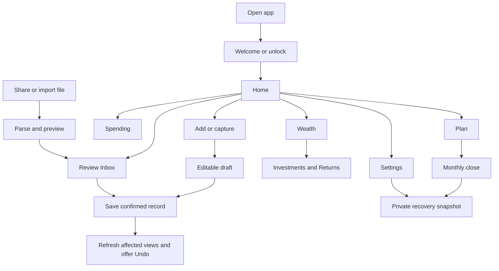
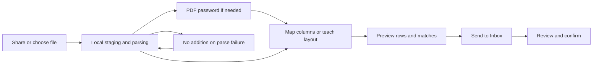
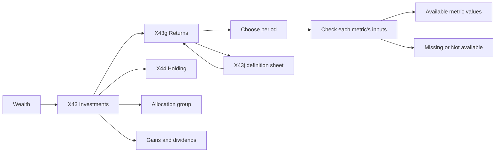

# Contour usage flows — reference (USAGE_FLOWS_REFERENCE.md)

- This file holds the full journey detail: numbered steps, recovery text, check descriptions, component contracts and screen coverage.
- [USAGE_FLOWS.md](./USAGE_FLOWS.md) is the short core. Both files use the same ids (F01–F21, `G01`–`G14`, C01–C12, Fxx-A checks) and have the same authority.
- Version 1.5 · 16 October 2026 · WIDGET-ARCH-001: in-app widget framework and editing paths aligned from Phase 1; prior save/recovery and gateway corrections retained.

Read [AGENTS](./AGENTS.md), the applicable [SPEC](./SPEC.md) and [DESIGN](./DESIGN.md) sections, then the flow. Screen references: [design gallery ↗](./design/gallery.html) and [docs/screens/SCREENS.md](./docs/screens/SCREENS.md). [DECISIONS](./docs/DECISIONS.md) records selected corrections. Wealthfolio is out of scope.

## Authority and readiness

- SPEC owns product behaviour and numbers. [SYSTEM_DESIGN](./SYSTEM_DESIGN.md) owns storage, workers, calculations, privacy and recovery. [DATABASE_DESIGN](./DATABASE_DESIGN.md) owns tables, write boundaries, queries and migrations. DESIGN owns interface components.
- This guide maps flows and names gaps. It does not override those documents.
- Use the current inventory in docs/screens/SCREENS.md and the recorded SPEC/DESIGN correction gates; prototype figures are not financial evidence.
- Do not copy sample figures, HTML event handlers or missing browser interactions into domain code.
- ARCH-001 supersedes legacy gallery actions for email, exports, backup folders, device transfer and financial OS widgets. They have no app routes.
- Only public market data uses the network. Recovery stays on the phone.
- PF-01 blocks real-user iOS persistence and release while strict OS-level phone confinement is unproven. Encryption and exclusion flags do not close that gate.

Status words:

- **Defined:** the flow comes from the current SPEC. Build it with its data and interface rules.
- **Correction gate:** a reviewed choice conflicts with, or is absent from, the current contract. Reconcile the cited SPEC/DESIGN/schema text in a documentation change before you build the affected behaviour. Unrelated flows can proceed.
- **Design gap:** a destination has no separate screen reference. Use its component contract below. Define its reference and acceptance states before you build it. Do not invent an X id.

## Corrections to settle before the affected work

| Gate | Current contract or gap | Selected correction | Flows |
|---|---|---|---|
| `G01` Account prerequisites | Account forms arrive in v1 Phase 4, after expense entry and import. | Move basic bank, cash and card setup plus opening balances to the base phase. Define an inclusive balance anchor and accepted postings after it. REVIEW-002 F02 / PRODUCT-01. | F01, F03, F05, F06, F10 |
| `G02` Identity and confirmation | Content hashes and autoCreate can suppress real events or create actual payments from schedules. | Source identity supports retries. Equal content is only a match candidate. Track one Expected occurrence and its unpaid remainder; require confirmation or an accepted matching record. Define one-off future payments apart from recurrence. REVIEW-002 F03–F04; FLOW-001. | F05–F07, F09, F13–F14 |
| `G03` Investment events | Cash basis, price precision and linked cash/security effects are incomplete. | DB-001 defines linked events and exact quote storage. Cash-basis and complete attribution definitions stay prerequisites. Position observations never invent trade history. F05–F06 / MATH-009. | F10–F13 |
| `G04` Basic returns | SPEC 17 puts Returns in v1.1; its TWR formula has a flow-timing error. | PERF-001 moves basic XIRR/TWR and annualised TWR to v1 Phase 4. Correct SPEC 4.5, 6.7, 13.12, 17 and DESIGN X43/X43g/X43j together. Benchmark chart enhancements stay v1.1. | F11 |
| `G05` Interface entry and action hierarchy | Home priority/chooser rules conflict; entry controls and Inbox primary-action precedence are incomplete; Repeating uses general expense Add. | Reconcile the combined Home hero/chooser scope. Search below the Home title; Main number in Settings > App > Home. Repeating Add opens a schedule form. In Inbox, an unresolved decision owns the primary action; Confirm is secondary until decisions are resolved. REVIEW-002 UX; FLOW-001 for entry placement. | F02, F07, F09, F19 |
| `G06` Undo access | SPEC gives only a five-second toast. | Keep the toast and add persistent history access. Undo a complete event/batch; keep later dependent edits. UX-010. | All confirmed writes |
| `G07` Local capture engines | ML Kit metrics and the generic Android offline preference conflict with the network policy. | Verified local engines only; no cloud fallback. Unsupported devices keep typed/file entry. REVIEW-002 PLATFORM-01/02. | F04, F06, F12, F19 |
| `G08` Provider capture | Resolved in SPEC 8.12/10.5 and ARCH-001. | No email/Drive/IMAP connector. Accept already local attachments only; never fetch a link or cloud file. X82 has no route. Native dependency/traffic verification stays required. | F19 |
| `G09` Goals and expected values | Allocation caps and tax/dividend schedule semantics are incomplete. | Cap active account allocations at 100%. A future tax/dividend schedule is not an actual balance or receipt. F07–F09. | F14–F17 |
| `G10` Month close | The first-days design says closed before completion; no snapshot revision policy. | Show a month closed only after Save and finish. DB-001 defines immutable saved revisions, coverage and evidence pins; later corrections create a traceable revision. Financial attribution fixtures stay prerequisites. UX-009; FLOW-001. | F02, F18 |
| `G11` Local recovery | ARCH-001 replaces portable backup and merge with same-device recovery. | SYSTEM_DESIGN defines encrypted generations, attachment/key leases and atomic replacement. Prove interruption safety on devices before shipping. No external file or merge. | F20 |
| `G12` Draft lifecycle | No durable-draft contract for Close, process death and multiple unfinished forms. | Encrypted drafts keep only structured editable fields. Back/Close keeps them; explicit Discard deletes them; Save clears them after commit. SYSTEM_DESIGN: no automatic expiry, separate draft IDs, schema-aware migration. DB-001 defines the draft/intent schema and migration acceptance; production migration tests stay required. FLOW-001 / ARCH-001. | F03–F06, F10, F15–F17 |
| `G13` Transfer cost | SPEC 6.3 can treat charged fee plus calculated exchange spread as a fee posting. | Post the actual charged fee once. Show exchange spread as a comparison only. Reconcile fee classification with spending and net worth first. FLOW-001. | F05 |
| `G14` Financial definitions | Four-part net worth bridge, calculator formulas and full dated sample history are incomplete. | Apply REVIEW-002 finance/math corrections and build canonical dated fixtures. Never turn unexplained changes into a residual. | F02, F08, F10, F17–F18 |

A gate names prerequisite work. It is not a request for user approval where the user already selected the correction.

## Journey map



### Flow index

| Flow | User task | Release in the current SPEC |
|---|---|---|
| F01 | Start, unlock, reach the first useful screen | v1 Phase 1; account prerequisite `G01` |
| F02 | Read Home, inspect a number, hide amounts, search | v1 Phase 4; hidden state from Phase 2 |
| F03 | Add or edit an expense or income | v1 Phase 2 |
| F04 | Enter by voice, QR or receipt | Voice Phase 2; QR/receipt Phase 3 |
| F05 | Record or match a transfer and card payment | v1 Phase 2; currency transfer v1.1 |
| F06 | Import a statement or broker file | v1 Phase 3 |
| F07 | Review and confirm Inbox items | v1 Phase 2 |
| F08 | Inspect spending, filter, set limits, edit or delete | v1 Phase 2 |
| F09 | Maintain categories, rules and repeating payments | v1 Phase 2 |
| F10 | Add an account or asset and update its value | v1 Phase 4; basic setup `G01` |
| F11 | Inspect portfolio value, returns, allocation and gains | Portfolio Phase 4; Returns/sector v1.1, with `G04` |
| F12 | Reconcile positions or investment transactions | Draft parsing Phase 3; application needs the holdings model |
| F13 | Confirm shares from work | v1 Phase 4 |
| F14 | Inspect the calendar and expected cash flow | v1 Phase 4 |
| F15 | Create and track a goal | v1.1 |
| F16 | Review a payslip or policy; inspect protection | v1.1; local emergency preview v1.2 |
| F17 | Inspect tax records or use a calculator | v1.2 |
| F18 | Close a month and save its summary | v1 Phase 4 |
| F19 | Change settings, enable a capture source, update prices | Settings base; automatic sources v1.1 |
| F20 | Create or restore a same-device recovery snapshot | v1 Phase 4 |
| F21 | Control privacy, network access and deletion | v1 base, expanded as capabilities ship |

## Shared interaction contract

### Navigation and context

1. Home, Spending, Wealth and Plan are navigation destinations. Add opens a form or chooser; it is not a fifth tab stack.
2. Child views open above their caller. Back returns with period, filters, selected account, scroll position and focus intact. A tab switch restores that tab's last state. Re-selecting the active tab returns to its root (FLOW-001).
3. Sheets keep the parent route. A read-only sheet closes to the same number or row. In edit sheets, Done copies changes into the parent draft; Back/Cancel discards only that sheet's edits.
4. Context Add follows SPEC 5.3: Home/Spending → expense; Wealth → asset/account first; Goals → goal first; Protect → policy first; Calendar/Tax → repeating payment first. The Repeating override needs `G05`.
5. The host route sets Add context and section. Returns opened from Wealth keeps Wealth context. Do not reset Add context because a child has another colour.
6. Apply release, feature, platform and permission checks at every entry: tab, header link, Add option, import type, deep link, notification, shortcut, background source. A disabled feature is absent from navigation. A direct unavailable target returns to its nearest available parent with a factual status; it never enables the feature.
7. A pending share/deep link waits behind unlock. Validate its identifiers again after unlock. It may navigate or open a draft; it never replays Save, Confirm or Delete. Route state holds only local identifiers and intent; never amounts, merchants, credentials or file content in URLs or logs.
8. X03, X11, X12, X24, X25, X62 and X89 are states of a flow, not separate navigation stacks. Allocation grouping is one route with a group argument.
9. The HTML gallery preview toolbar, shared sample-period handler, full-page glossary and nonfunctional legacy controls are not the routing contract. X43jGlossary stays an AppSheet opened from its caller.

- The active modal owns focus; its dimmed parent Add control is inactive.
- Form-field choices create no extra control rows.
- Under `G05`, Inbox has one filled content action: resolve the outstanding decision first, Confirm secondary. Confirm becomes primary after blocking decisions are resolved.

### Drafts, saving and cancellation

- A parser produces a draft with per-field confidence. It writes no actual transaction, holding, balance or payment.
- Manual, quick-add, voice and receipt forms: **Save** is the confirmation. They commit directly; no second Inbox step.
- Statement/broker transaction preview **Send to Inbox** publishes staged drafts and batch metadata. No actual totals change. **Confirm** later commits accepted records. F12 holdings observations and F16 structured documents use their specified direct review confirmation, with the same source identity and command safeguards (EXECUTION_SAFETY2.1).
- `G12`: Back/Close keeps structured fields locally and shows "Draft kept". Reopening the same form resumes them. Explicit Discard deletes the draft. A type switch or another capture never silently overwrites an existing draft.
- Audio is never saved. Clear voice transcripts after Save/Cancel, on leaving capture, and on background/lock. Stop microphone/camera on background or lock. After unlock, resume structured fields, never capture hardware. Temporary source files follow their parsing/deletion lifecycle; they are not in draft storage.
- Show validation next to the affected input. Missing optional category or note does not block Save. A split reconciles exactly. A missing required amount/account is never filled with zero.
- On confirmed Save: disable duplicate submission, validate current references, commit all linked changes and ChangeLog in one repository transaction, then clear the draft. On validation failure or a proven rollback before commit, keep the editable draft and write nothing of that operation. If the commit outcome is unknown, freeze the submitted payload and resolve the original operation ID through its receipt before editing or retrying. A proven commit retries the submitted draft even if a later read-store notification, read or background rebuild fails. Preserve the receipt and accepted facts; retry only read/derived work, with Updating or unavailable state until recovery.
- A retry uses the same operation identity. It never creates a second transaction or repeats a batch. Show success and Undo only after commit. Test a lost reply, a failed read after commit and a failed background rebuild: each retains one receipt and one fact set; no accepted payment becomes a new editable submission or receives a new operation ID.
- Undo reverses the whole event/batch. If later edits depend on it, keep those edits and open an explicit resolution flow; never silently replay stale values. Persistent access needs `G06` and C06.

### States that every flow must handle

| State | Required behaviour |
|---|---|
| First use / None recorded | Point to the next action with the existing Add or import control. No false zero. |
| Loading / recalculating | Show last data and its timestamp; mark updating values. Never mix periods or accounts in one result. |
| Missing | Name the missing input and a local action (enter a balance, import history). Never manufacture returns or cost basis. |
| Estimated / old quote | Show Est., date and basis. Keep the latest valid quote if refresh fails. |
| Expected | Keep projected payments, vests and receipts apart from actual owned values and actual spending. |
| Denied permission / unavailable local engine | Keep structured fields; offer typed/file entry. Settings action optional. No repeated automatic prompts; no cloud fallback. |
| Network off / offline | Cached/manual paths work. No automatic request starts. Capture files still parse locally. |
| Hidden | Mask amounts in text, semantics, chart tables, tooltips and breakdowns. Percentages stay visible (SPEC 4.9). No amount leak through chart coordinates or axis labels. |
| Invalid or ambiguous calculation | Show Not available with a reason, distinct from Missing and known zero. |
| Deleted or inaccessible target | Return to the available caller and say the record is unavailable. Never show a stale financial detail as current. |
| Interrupted operation | Resume a staged draft or show the committed result from its operation ID. Never claim both failure and a second success for one write. |

## User journeys

Each journey lists Sources, Entry, numbered steps, Recovery (where it differs from the shared contract) and Checks.

### F01 Start and unlock

**Sources:** SPEC 6.1, 11; DESIGN Start.

**Entry:** launch, locked deep link, shared file.

1. New install → `X01Welcome`. Confirm main currency. Start creates local settings → `X03HomeFirstRun`. No sign-in or optional permission.
2. First-run list links, when each exists: account setup (C01), statement import (`X63ImportHub`), expense (`X20AddExpense`), app lock (C10), private recovery (`X83Backup`).
3. Save a basic account and dated opening balance once → Home recalculates available values. Unknown inputs stay Missing; an entered zero is real. `G01` must land before base-phase acceptance.
4. Later launch/timeout with lock on → `X02Lock`. Success resumes the pending target or Home. Failure/cancel stays locked; no data change.

Phase 1 also builds the independent widget registry, surface host, layout repository and editor (SPEC W8). First-run Home uses that host with the approved X03 catalogue/defaults; a missing catalogue row is a product prerequisite, not a fixed-card exception. W-A–L run with test-only widgets and bundled layout data before later financial modules are available. See [WIDGET_FRAMEWORK](./WIDGET_FRAMEWORK.md).

**Recovery:** optional setup is skippable. Background blurs content. Restore draft/route context only after authentication.

**Checks:** F01-A only currency, then Home; F01-B optional permissions denied, manual use works; F01-C a shared file exposes no content before unlock.

### F02 Read Home and inspect a number

**Sources:** SPEC 6.2, 4.3; `G05`, `G10`, `G14`.

**Entry:** Home tab, return from a task.

1. `X10Home` reads current aggregates. A number → `X40bAboutNumber`; Available → `X14ToUseBreakdown`. Close returns to the same position.
2. Attention card → its card, forecast, Inbox or repeating item. Wealth summary → `X40WealthOverview`. Month totals → their Spending view.
3. Hide amounts → `X12HomeHidden`, a global presentation state kept across sheets and tabs. Unhide restores display, not data.
4. `G05` (FLOW-001 placement): Settings > Screens and widgets > Main number on Home → `X13MainNumberSheet`; selection updates the preference; option set gated by `G05`. Search below the Home title → `X15Search` (local) → `X39TransactionDetail` or account detail; Back keeps the query.
5. First days of a month: `X11HomeMonthStart` links to `X70MonthClose`. Under `G10`, "closed" only after a completed close.
6. Edit widgets, or Settings > Screens and widgets > this screen, opens the same surface editor. Hide/reorder/add, section moves, cross-section widget moves and Tiles edits change one private candidate. Sizes and titles come from the installed bundled file. Add widget places each widget at the size and position from the file's add block; previews observe only already loaded shared values, remain inert and obey hidden amounts; a cold preview shows "Not loaded yet" and starts no query. Move up/down at a section boundary moves a widget into the next section; empty sections show in edit mode. Removed sections keep distinct keys and no title, with known children still editable; dormant children cannot be lost through a parent edit. A layout saved by a newer app version is read-only; Default stays available. Undo reverses one action; Cancel restores the candidate's initial state without writing. Home Default includes Quick look tiles. Done commits all touched preferences atomically; no financial recalculation.

Unknown/unreleased keys are retained and not shown. Conflicts or uncertain replies follow DATABASE_DESIGN 5.1; they never overwrite a later reset. The editor exists from Phase 1, while financial Home cards follow their release and definition gates. X03/X10/X11/X12 are states of one Home surface. LAYOUT-UPGRADE remains an open product gate (DECISION-PENDING); its interim new-release behaviour, including when "New in this version" clears, is specified in W13 and WIDGET_FRAMEWORK 5.

**Commit:** explicit preferences only; no financial write.

**Checks:** F02-A breakdown period/currency/coverage; F02-B hidden values in semantics and tables; F02-C incomplete months never called closed.

### F03 Add or edit an expense or income

**Sources:** SPEC 3.2, 6.3, 9.3.

**Entry:** Add, repeat-last, quick add, Edit from a payment.

1. `X20AddExpense`: new draft or explicit resume. Amount has focus. Date/account/currency use supported defaults. Edit carries the original record ID.
2. Amount or sentence → local parser fills fields; uncertain fields stay editable. No ledger write.
3. `X21CategorySheet` and `X22DetailsSheet` edit copies; Done returns fields to the draft.
4. `X23Split` shows the remainder. Save enabled only when parts equal the total. Returns to the parent draft.
5. Save: validate required fields and source account. One transaction writes payment, split/tag links and ChangeLog. Edit changes the existing event.
6. Return to caller; refresh account/spending/Home; show Undo.

**Recovery:** missing account → C01 or account picker → same draft. No category is allowed. Back/Close/discard per `G12`.

**Checks:** F03-A uncategorised payment saves; F03-B split saves once after repeated taps; F03-C edit does not duplicate; F03-D Undo restores balances and split links.

### F04 Voice and receipt capture

**Sources:** SPEC 6.3, 8.3–8.5, 8.10; `G07`.

**Entry:** Speak, long-press Add, Scan QR, photo.

1. Speak/long-press Add → `X87MicPermission` (first use) → OS request. With permission and a verified local recognizer → `X24VoiceListening`.
2. Stop or silence → `X25VoiceFilled`, the F03 payment draft. Uncertain fields marked. No amount → keypad stays active. Save per F03. A second detected amount is offered only after the first Save.
3. Scan QR → `X27ScanQR` after camera permission. Supported receipt payloads fill the payment review. Unknown payload → receipt-photo path. Never open a QR URL automatically.
4. Photo/picked image → `X28ReceiptReview`. Correct fields; choose to keep an encrypted image or not. Save commits one payment and, if selected, its attachment link.

**Recovery:** denied permission, unsupported language or parser failure keeps manual entry. Never save audio. Without retention, delete temporary receipt content after parsing. With retention, the encrypted attachment is durable only with confirmed Save; Cancel/Discard still deletes the temporary image. Back keeps structured fields (`G12`), never an orphan image.

**Checks:** F04-A voice offline; F04-B denial fallback; F04-C no actual record before Save; F04-D encrypted retention and cancellation cleanup, including retention toggled on before cancel.

### F05 Transfers and card payments

**Sources:** SPEC 4.2, 6.3; `G01`, `G02`, `G13`, `G14`.

**Entry:** Transfer in form/chooser, Inbox candidate, card statement.

1. Transfer → `X26Transfer`: different owned From/To accounts, amount, date. Cross-currency → `X26bTransferFX` only when released.
2. Save writes linked debit and credit together. Neither principal side is income or spending. A charged fee is separate; `G13` settles its class; calculated FX spread is informational.
3. Imported sides: review in `X60Inbox`/`X61InboxItemSheet`. Confirm creates each new posting once, reuses a confirmed posting, links both sides atomically, never copies an existing pair. Uncertain counterpart stays unresolved.
4. Card repayment = transfer linked to the statement obligation. `G02`: partial payment reduces cash and the statement remainder once.

**Recovery:** a missing rate blocks derived conversions, not entry of documented sent/received amounts. Never invent a mid-rate.

**Checks:** F05-A no income/spending principal change, and no net worth principal change when both accounts share net worth scope; F05-B imported pair confirms once; F05-C paying 500 of a 1,240 statement forecasts only 740; F05-D one actual fee posting; F05-E a transfer across the included/excluded net worth boundary counts as Other recorded changes (REVIEW-002 F01, `G14`).

### F06 Import a statement or broker file

**Sources:** SPEC 6.4, 8.6–8.9; `G01`, `G03`, `G07`.

**Entry:** share into the app, `X63ImportHub`.



1. Check type and release. Platform handoff stages locally; the app parses after unlock.
2. Encrypted → `X64PdfPassword`. "Remember" uses secure storage only. Wrong password keeps retry; no financial write.
3. Known layout → `X65ImportPreview`. Unknown PDF → `X66TeachOnce`; CSV/Excel → `X67CsvMapping`. Save a layout only after a usable preview. Cancel changes no financial record.
4. Preview: candidate rows, existing matches, new rows, source account, parsing uncertainties. Statement balance observations stay apart from transaction rows. `G01` stops replay of records already in a closing balance.
5. Send to Inbox atomically saves batch and draft rows → `X68ImportDone`. Only Inbox counts change. Open Inbox → F07.
6. Re-imported file/source identities are recognised. Equal content alone is not a duplicate. `X88ImportError` applies before staging; "Nothing from this file was added" must be true.

**Recovery:** retry parsing, teach another layout, read an image locally, or choose another file. A later confirmation error keeps staged drafts; never show "nothing added" then. Delete the temporary source copy after parsing; keep permitted fields and source identity.

**Checks:** F06-A normal/localised/broken/repeated files; F06-B no totals change after staging; F06-C restart without duplicate staging; F06-D no source content in logs or retained raw files.

### F07 Review the Inbox

**Sources:** SPEC 6.4, 9.7; `G02`, `G06`.

**Entry:** Home Inbox button, Import done.

1. `X60Inbox`; empty → `X62InboxEmpty`. Source filter changes the list, not records.
2. Resolve transfer/duplicate/refund decisions before confirming affected items. Accept/reject of a match stages the decision; only Confirm writes the actual event. Ambiguous items stay unticked.
3. Row → `X61InboxItemSheet`: edit fields/category and return, or Confirm the item. A category change can offer a rule; the rule exists only after separate explicit acceptance.
4. Confirm ticked: preflight ≤ 5,000 selected source rows, ≤ 100,000 logical row effects, ≤ 16 MiB prepared plan. Over a limit: drafts and selection unchanged; user picks a smaller set; no hidden splitting. Validate the whole batch against the current database. One repository transaction writes records, relationships, Inbox decisions and ChangeLog. Never partly accept a failed batch.
5. Refresh affected views. Unticked items stay. None left → empty state. Undo reverses the complete batch.

**Recovery:** source deletion removes a staged item only; deleting a confirmed event uses F08. Repeated Confirm/retry creates no second event.

**Checks:** F07-A uncertain rows stay unticked; F07-B exact selected count/total; F07-C rollback on one invalid row; F07-D repeat confirmation and batch Undo.

### F08 Inspect spending and maintain payments

**Sources:** SPEC 6.5; `G06`, `G14`.

**Entry:** Spending tab.

1. `X30SpendingOut` has no sub-tab row (SPEND-TABS adopted). Rows open `X31SpendingIn` (Money in), `X32Budget` (Budget), `X34Repeating` (Repeating), `X30cWhereItGoes` (Where it goes), `X37Transactions` (All payments) and `X33EditLimits` (Edit limits). Period button opens a picker, not a control row.
2. In `X30cWhereItGoes`, its one control sets the denominator. Category rows → `X36CategoryDetail`. Invalid denominator → Not available. Refunds/negative totals use signed charts or tables.
3. All payments → `X37Transactions`. `X38FilterSheet` applies only on Show; Clear resets inputs; Back keeps the last applied filter.
4. Payment → `X39TransactionDetail`. Edit reuses F03 with its ID. Delete → `X39bDeleteDialog`; confirm soft-deletes event and linked effects atomically → caller with Undo.
5. `X33EditLimits` Save writes limits only. Recalculate the budget period; payment history unchanged.
6. Reimbursable / Refund expected records an expectation; no incoming cash. Confirmed reimbursement links to the original payment, reduces its expected unpaid balance, and is excluded from income. Confirmed refund reduces spending in the original category under the selected refund recognition period. Partial settlement, attribution and reversal stay behind `G14`.

**Checks:** F08-A filter/Back keeps context; F08-B cancelled delete leaves data; F08-C delete/Undo changes totals once; F08-D known zero, Missing and net refund differ; F08-E limits leave balances; F08-F an expectation creates no receipt, and a confirmed settlement changes its linked balance once.

### F09 Categories, rules and repeating payments

**Sources:** SPEC 6.5, 6.9, 8.9; `G02`, `G05`.

**Entry:** `X84Rules`, `X34Repeating`.

1. `X84Rules`: Categories or Rules. Add/edit via C03. Save validates and writes the rule with ChangeLog. No silent reclassification; retrospective application needs an explicit reviewed batch.
2. `X34Repeating` → `X35RepeatingDetail`. `G05`: Add opens C02 with schedule context. A saved schedule creates no completed payment.
3. Each due occurrence is generated once. `G02`: it stays Expected, with at most one Inbox item. Accepted matching payments settle its unpaid remainder.
4. Stop repeating ends generation from the effective date; confirmed history stays. A provider cancellation address is inert local text: no launch, copy or share. Stop does not cancel the provider subscription. The X35 browser link is obsolete.
5. A changed actual amount creates a dated price-change fact after matching. Editing an estimate never rewrites older actual payments.

**Checks:** F09-A repeated background runs create one occurrence; F09-B confirmation and later import link one payment; F09-C Stop keeps history; F09-D declined rule offer writes no rule.

### F10 Accounts, assets and balances

**Sources:** SPEC 6.6, 9.2; `G01`, `G03`, `G14`.

**Entry:** Wealth tab, Wealth Add.

1. `X40WealthOverview`. Owned rows → account/asset detail. Owed rows → `X46Owe`, `X47LoanDetail`, `X48CardDetail`. Expected items stay outside owned totals.
2. Add → `X29AddChooser` → `X42AddAssetType` → C01. `X42bAddDeposit` is the deposit reference for the shared form family; other types use SPEC 6.6 fields.
3. Save creates account, dated observation and method/details together. A loan is never both an Account and an independent Debt balance.
4. `X41AccountDetail` → `X41bUpdateValue`. Save records value and date; interest/contribution/depreciation estimates restart from the real anchor. Reconcile dated postings (`G01`); never replay all history.
5. Inclusion/liquidity switches change aggregates only, no money movement. Unavailable value stays Missing.

**Recovery:** missing method inputs stop that estimate, not display of a known dated value.

**Checks:** F10-A create/reopen account; F10-B balance-anchor cutoff; F10-C real value replaces an estimate without duplicate assets; F10-D liability/card credit/overdraft signs; F10-E cancel value edit.

### F11 Portfolio and performance

**Sources:** SPEC 6.7, 12, 13.12; PERF-001; `G03`, `G04`.

**Entry:** Wealth > Investments.



1. `X43Investments` scope: selected investment accounts and their cash, once. Value, dated daily change, all-time gain and personal return, each with its period.
2. `X43gReturns`: one period control. Refresh cumulative TWR, annualised TWR, XIRR and any supported benchmark for exactly those dates and currency. Back keeps caller context. Gallery set 1M/1Y/3Y/5Y/All is a PERF-001 presentation pending `G04`.
3. Under one full calendar year: cumulative TWR and money-weighted return for the period; never label it XIRR. Annual periods: personal XIRR per year. Annualised TWR = CAGR of the return index, not raw balance growth.
4. Availability per metric. XIRR needs opening/closing values and dated external flows; TWR also needs flow-boundary valuations. Missing old cost can block gain but not a complete recent return. Multiple XIRR roots or no valid result → Not available.
5. `X43jGlossary` opens from the metric as a sheet on that term; Close restores caller and period. "Show as table" uses the same result object and dates, never a recomputed series.
6. Holdings → `X44HoldingDetail`. Allocation → `X43cAllocationClass`, `X43bAllocationMarket`, `X43dAllocationSector` or the currency state. Sector/look-through is gated. Gains, income, factual insights → `X43eGains`, `X43fDividends`, `X43hInsights`.
7. Price refresh per F19. `X89OfflinePrices` is the stale-price state; caller period and last data stay. Manual values work.

**Commit:** viewing, period, sorting and definitions write nothing financial. A deliberate benchmark preference writes Settings only.

**Checks:** F11-A exact dates across cards/chart/table; F11-B 100 →121 over 730 days gives 21% total and 10% annual TWR/XIRR without flows; F11-C deposits without growth give 0%; F11-D short-period labels; F11-E independent metric availability; F11-F benchmark uses TWR, matching period/currency and stated fee/tax basis.

### F12 Positions and investment history

**Sources:** SPEC 6.7, 8.6–8.7; `G03`, `G07`.

**Entry:** Investments > Import positions, broker files, manual entry.

1. Import positions → `X63ImportHub` filtered to position sources → local file/photo picker. Screenshot → parsed positions → `X45UpdatePositions` with differences and source dates. CSV → `X67CsvMapping` if needed → position preview. Resolve account/security matches explicitly. The HTML shortcut to X45 does not replace source selection and parsing.
2. Apply selected differences records a confirmed position observation. Never invent purchase dates, cost, lots, sale proceeds, contributions or returns. Quantity/value can be known while cost and history stay Missing.
3. Broker transaction files use F06/F07. Confirm links cash, quantity, lots, fees, tax and income as one event. Keep basis on internal/in-kind transfers.
4. Manual entry via C04. Reinvested income links one income event and one acquisition; no second external deposit.

**Recovery:** a ledger disagreement needs reconciliation; never overwrite it silently with a screenshot. Reapplying an observation is idempotent.

**Checks:** F12-A screenshot changes position, unsupported return stays Missing; F12-B duplicate source observation; F12-C dividend/reinvestment counted once; F12-D disposal and Undo restore linked lots/cash; F12-E incomplete broker rows stay drafts.

### F13 Shares from work

**Sources:** SPEC 6.6, 9.5; `G02`, `G03`.

**Entry:** `X49VestTracker`, Inbox item.

1. `X49VestTracker` shows upcoming shares as Expected. A passed date creates one confirmation item, not owned holdings.
2. In Inbox, review shares received, tax handling, destination account. Unknown withholding stays unknown.
3. Confirm links vest, lot/holding, documented withholding and any sale/cash event once. Recalculate Investments and net worth. Employer shares already in Investments are not added again.

**Checks:** F13-A upcoming vest excluded; F13-B repeated generation/confirmation no duplicate; F13-C withholding and net shares reconcile; F13-D later statement matches the confirmed event.

### F14 Calendar and forecast

**Sources:** SPEC 6.8, 4.4, 4.8; `G02`, `G09`.

**Entry:** Plan > Calendar.

1. `X50Calendar`: day → `X51DaySheet`; close returns to the same month/day. Dated Add → one-off payment draft with that date; recurrence needs an explicit choice. `G02`/FLOW-001: a future one-off saves as Expected; no actual balance change before confirmation. Calendar Add chooser follows SPEC 5.3; its repeating option uses C02.
2. Cash-flow card → `X50bCashFlow`. Rows → card, loan or repeating detail; Back keeps the horizon.
3. Forecast and Available use the same unsettled cash events. A card charge is spending on its charge date but affects cash once, through the statement payment.
4. A scheduled item is Expected; edits change projections only. Actual payment goes through F03/F07.

**Checks:** F14-A five stated unpaid events total 2,415 and leave 19,035; F14-B partial/already paid obligations not subtracted again; F14-C missing balances propagate; F14-D no next-income date → labelled 30-day horizon; F14-E dated Add creates no recurrence by default; an unconfirmed future item affects projections only.

### F15 Goals

**Sources:** SPEC 6.8, 9.6; `G09`.

**Entry:** Plan > Goals, when enabled.

1. `X52Goals` Add puts A goal first in `X29AddChooser` → `X53NewGoal`.
2. Target, optional date, linked account shares. Current value comes from those accounts, investment cash once. Never use all-investment totals for one account.
3. Save writes goal and allocation links only. Active shares of each source account are validated together; max 100%. A missing source value stays Missing.
4. Return to Goals. Value follows the source account. No money moves; net worth and Available unchanged.

**Checks:** F15-A 40% of the 98,600 Brokerage account gives 39,440; F15-B allocation cap, including concurrent saves; F15-C goal deletion leaves source assets; F15-D no-date goals invent no monthly target.

### F16 Linked documents and protection

**Sources:** SPEC 6.4, 6.8, 8.2; `G03`, `G09`.

**Entry:** local file pipeline, Plan > Protect.

1. Supported payslip → `X69Payslip`. Review proposed income/tax/pension/share-plan/benefit links and the salary-deposit match. A mismatch stays unresolved.
2. Add to these areas commits selected linked changes atomically. A matched net salary deposit is not a second income payment. A failed linked write commits nothing.
3. Policy document → `X69bPolicyImport`. Review fields and proposed premium/renewal links. Save policy is the confirmation; no Inbox step.
4. `X55Protect` → `X56PolicyDetail`; manual policy/claim edits via C05. Cover is not owned wealth. "None recorded" describes records, not insurance status.
5. `X57EmergencySheet`: local preview in v1.2. Linked records and coverage. No passwords or secure-store credentials. No PDF/file export or system share (ARCH-001).

**Checks:** F16-A matched payslip does not double income; F16-B mismatch blocks affected confirmation; F16-C one premium schedule; F16-D emergency preview has no credentials, keeps Missing labels, no outgoing route.

### F17 Tax records and calculators

**Sources:** SPEC 6.8, 13; `G09`, `G14`.

**Entry:** Plan > Tax, Tools.

1. `X58Tax`: recorded year totals, user-entered dates/limits. A future tax payment schedule does not prove a liability. C08 enters dates/limits with the proper record type.
2. Local tax-record table: period, currency, cost method, coverage. No outgoing export (ARCH-001). Never a jurisdiction-certified tax result.
3. Tools → `X59Tools` → `X59bHomeLoanCalc` or another calculator on the same template (C08). Recalculates from explicit inputs; creates no account, loan or payment.
4. Save preset stores inputs only. Missing/invalid inputs or undefined denominators → explained state. Apply corrected formula fixtures before acceptance.

**Checks:** F17-A calculation leaves balances; F17-B preset round trip; F17-C undefined/zero/rate/date boundaries; F17-D table coverage/method and no export; F17-E each shipped tool passes the corrected SPEC 13 fixture.

### F18 Monthly close

**Sources:** SPEC 6.9, 9.7; `G10`, `G14`.

**Entry:** Home month prompt.

1. `X70MonthClose` for a selected month. Start/resume its workflow record; calendar rollover never completes it.
2. Five steps: import statements (F06), review Inbox (F07), update values (F10), inspect open items, summary. Return from a child resumes the same step and month.
3. Continue or Skip records progress. Skipped/incomplete data keeps Missing/Estimated state and coverage.
4. `X71MonthSummary` previews. Save and finish atomically saves completion and its snapshot/revision. `G10`: later corrections create a traceable revised close.
5. After close, request a private recovery snapshot (F20). Check local space and keys; no destination or password-sharing step. Snapshot failure keeps the saved month and offers retry; the close is never undone.

**Checks:** F18-A skip/resume; F18-B completion only after Save and finish; F18-C snapshot coverage; F18-D backup failure keeps the close; F18-E correction leaves an auditable prior revision.

### F19 Settings and data sources

**Sources:** SPEC 6.9, 8.12–8.15, 12; `G07`, `G08`.

**Entry:** Home > Settings.

1. `X80Settings` links: `X81CaptureSources`, `X84Rules`, `X85Features`, `X86Privacy`, `X83Backup`, C10 for others.
2. Enable a source: check release/platform, explain access, request OS/provider permission. Save enabled state only after setup succeeds. Denial leaves it off; records intact.
3. Local source results stage to Inbox. Persist parsed fields and source IDs, never raw notification text. Advance the source cursor only after durable staging or explicit discard. No remote acknowledgement or email connection.
4. Source off stops scheduling and future ingestion; accepted records stay. An in-flight response rechecks source identity, durable policy/configuration revision, runtime capability and installation/database epochs in the staging/cursor transaction. Disable/re-enable and A→B→A configuration changes revoke older callbacks even when enabled again. See [EXECUTION_SAFETY](./docs/EXECUTION_SAFETY.md) 4.
5. `X82GmailBridge` is obsolete: no route, setup or switch. Email networking is prohibited. FinanceKit stays hidden until its local-only adapter and entitlement are verified.
6. Market sources default off. Enablement saves the provider and secures any credential. The restricted gateway accepts only public symbol/catalogue, price/history, instrument-detail and bounded public raster-logo requests through typed descriptors (SPEC 10.5; [SYSTEM_DESIGN](./SYSTEM_DESIGN.md) 11). Additional asset classes need their own reviewed descriptor and decoder bounds. FX stays manual/local import. Quote updates change input versions, not transaction history. Failure keeps last quote and date. Network off cancels work and rejects late responses.
7. Feature switches gate all related entry points and keep stored records. They never bypass release/platform checks.
8. Screens and widgets opens the same editor used on each customisable screen. Restore the default widgets resets all ten screen/tile preference surfaces in one writer transaction. A feature switch removes its widgets from rendering and Add widget but keeps their stored keys; re-enabling restores eligible placements without a layout rewrite.

**Checks:** F19-A denial/off states; F19-B source retry without duplicate drafts; F19-C disable during ingestion; F19-D no raw source persistence; F19-E no price request while off; F19-F unavailable routes stay unavailable through deep links.

### F20 Same device recovery

**Sources:** SPEC 14; SYSTEM_DESIGN 12–13; ARCH-001; `G11`.

**Entry:** `X83Backup`, close completion.

1. `X83Backup` is the local recovery view: create a private snapshot or inspect completed ones. No external folder, export, share, merge or cross-device action.
2. Reserve space, capture a consistent database state, pin attachment/key versions. Publish the complete encrypted snapshot only after validation, then update the completed date. Failure keeps the last valid snapshot.
3. Select a snapshot. Prepare a new encrypted generation; validate keys, schema, references, retained attachments; show replacement confirmation (C09). Active records untouched during staging.
4. On confirm: pause writers/readers, disable market networking, invalidate its policy epoch, atomically switch the complete generation (SYSTEM_DESIGN 13). Never merge rows into active data.
5. Reopen and verify before retiring old files/keys. Reset the database epoch; cancel old jobs/cursors; invalidate previous drafts. Recalculate disposable projections with explicit updating states.
6. State scope: no restore of a lost phone, uninstalled app or unavailable device keys. No data leaves the phone.

**Checks:** F20-A retained receipt restores locally; F20-B wrong key/damaged/missing attachment leaves active records; F20-C Cancel keeps current data; F20-D no success for an incomplete snapshot; F20-E every interrupted install selects one complete generation; F20-F no export/merge path; no restored setting starts networking.

### F21 Privacy and deletion

**Sources:** SPEC 6.9–6.10, 10.5, 11.

**Entry:** Settings > `X86Privacy`.

1. `X86Privacy` shows enabled services and device processing. Turn off all network → stated confirmation dialog → disables future network operations, including scheduled work. Cached/manual workflows stay.
2. Delete all data → destructive confirmation. Cancel leaves everything. Confirm: durably enter deleting, rotate the shared install epoch, revoke new/native capture admission, drain/reconcile all writer leases, then remove active/staged/recovery generations, attachments, keys, templates, cached prices, secure-store entries and pending capture. Deletion intent survives restart. Welcome only after cleanup. Old extension callbacks cannot publish into the new epoch.
3. State that deletion includes all private recovery snapshots. Contour makes no external backup (ARCH-001); deletion claims no control of independently created files outside its container.
4. Privacy state, lock and background blur apply to deep links, capture and restored sessions, not only Home.

**Checks:** F21-A network disable reaches all adapters; F21-B cancel deletion; F21-C confirmed cleanup and Welcome; F21-D recovery copies and keys deleted; F21-E background/lock/hidden states expose no values.

## Components without separate screen references

These are implementation contracts, not screenshot IDs. Use existing templates and SPEC fields. A planner assigns final route names, references and acceptance states before the feature task starts.

| Contract | Entry and result | Template and prerequisite |
|---|---|---|
| C01 Account or asset editor | First-run/account picker or X42 type chooser → validated account, observation and type details → caller. Type/currency/account ID are explicit arguments. | FormScreen; deposit reference X42b; SPEC 6.6 required fields; `G01`. |
| C02 Scheduled payment editor | Explicit repeating choice from Calendar/day/Repeating Add → schedule draft → Save schedule → caller. A one-off future payment uses the shared payment form with recurrence off and an Expected state. | FormScreen; X20 form and X35 detail content; `G02`, `G05`. |
| C03 Category or rule editor | X21 or X84 → category/rule draft → Save → caller. Retrospective application is a separate reviewed batch. | FormScreen or AppSheet; SPEC 9.3. |
| C04 Investment event editor and reconciliation | Holding/account/import discrepancy → dated event draft and linked effects → confirm → originating account/holding. | FormScreen plus reviewed difference list; `G03`. Define every supported transaction type before exposing it. |
| C05 Policy and claim editors | Protect/detail/Add → structured draft → Save linked records → caller. | FormScreen; X69b gives policy fields; SPEC 9.6. |
| C06 Activity history and Undo resolution | Success toast/history → inspect event/batch → Undo or resolve dependencies → refreshed caller. | DetailScreen with AppSheet for conflict detail; `G06`. No arbitrary overwrite. |
| C07 Generic selectors and metric tables | Account/date/period/benchmark/group selection or Show as table → selected value/view state → caller. | AppSheet/AppTable with existing controls. Currency allocation is a state, not a screenshot ID. |
| C08 Tax date, limit, debt and calculator forms | Tax/Tools/Wealth → validated inputs → explicit record or preset Save, as labelled. | FormScreen; separate a calculation preview from an actual record; `G09`, `G14`. |
| C09 Restore and destructive confirmation | Backup/privacy action → factual consequence preview → explicit confirm or cancel. | AppDialog, or AppSheet plus AppDialog; `G11`. |
| C10 Settings and permission forms | Settings/source action → settings or OS permission result → same settings/source row. Includes provider setup, manual quote/FX input, local recovery retention/status, lock and Home preferences. | FormScreen/AppSheet; denied/unavailable states keep local fallback; secrets in secure storage. `G05`, `G07`, `G08`, `G11` apply to their settings. |
| C11 Structured draft lifecycle | Resume existing form, select a draft, or Discard → editable draft or caller. | Existing form/sheet components plus encrypted draft storage; `G12`. No automatic expiry; distinct draft IDs; schema migration and restore invalidation per SYSTEM_DESIGN 5.2. |
| C12 Account and asset-group list | Investments Accounts or a grouped Wealth row → scoped account list → X41 or the account detail → same list. | DetailScreen; keep group/scope and caller context; no implicit account creation. |

## Implementation handoff

### Build order

1. Reconcile the correction gates the next feature needs. Never mix normative fixes and feature code in one pull request.
2. Build money/date/state types, local repository transactions, record identity and ChangeLog. Specify draft/occurrence/revision storage before dependent screens.
3. Build shared layout templates and state variants, including accessible Missing, Expected, old-price, hidden and large-text states.
4. Complete F01/F03/F07 with basic accounts. Then capture/import, Spending and repeating workflows, within published phase boundaries and approved corrections.
5. Add Wealth/valuation and investment event history before performance. Complete canonical fixtures before accepting XIRR/TWR or a net worth bridge.
6. Add calendar, monthly close and same-device recovery. Enable later Plan/source/calculator features only after their release and correction gates pass.

### A task must name its contract

Use this shape in the task and pull request. Operation names are descriptive, not existing APIs.

```
Flow and steps: F07 steps 2–5
Screens and templates: X60Inbox, X61InboxItemSheet, X62InboxEmpty
References: SPEC 6.4 / 9.7; DESIGN 5 / 6; G02 and G06 status
Inputs: source IDs, draft IDs, selected rows, caller context
User actions: resolve match, edit row, confirm selected, undo
Read model: visible rows, selection total, pending decisions, coverage
Commit boundary: one ConfirmInboxBatch operation
Written records: accepted events, links, Inbox decisions, ChangeLog
Success: refreshed list and totals; caller context retained
Failures: invalid row, stale match, interrupted write, repeated submission
Cancellation: no accepted financial record; retain staged drafts
Checks: F07-A through F07-D, relevant domain fixtures and screen variants
```

## Acceptance matrix

| Test family | Required evidence |
|---|---|
| Navigation | Each documented entry reaches its destination; Back restores context; direct/deferred routes respect gates and lock. |
| Draft and commit | No financial mutation before Save/Confirm; staging leaves totals unchanged; retry is idempotent; linked writes are atomic. |
| Financial correctness | Domain tests first; exact money/Decimal/FX rules; canonical dated fixtures; missing inputs are not zero. |
| Recovery | Denial, offline, parser failure, interrupted writes, later dependent edits and restore failure keep supported data. |
| Interface | Light/dark, text 1.0/2.0, narrow width, 44×44 targets, keyboard and screen reader; one control row/add action; labelled chart/table equivalence. |
| Privacy | No raw audio/source text or personal data in logs; temporary files cleaned; permitted network folders only; native SDK traffic checked. |
| Usability | Record total taps, amount-entry taps, action taps and elapsed time separately. Apply SPEC 3.1 to delivered tasks only; report real user-test results. |
| Release | Feature visibility, Add options, import types, deep links and background sources agree with one release matrix. |

Fxx-A identifiers are acceptance requirements, not tests already run. A finished task still needs the AGENTS checks and specialist review.

## Screen coverage

Every gallery figure, with its flow. "Return" means the recorded caller, not a fixed Home redirect. Release comes from the owning flow; gates still apply. Links open the visual reference; screen descriptions are in docs/screens/SCREENS.md. The name after each link is the prototype list name (SCREENS.md index); rows follow the grid order.

| Design reference | Flow | Surface | Entry → action and destination |
|---|---|---|---|
| [X01Welcome ↗](./design/gallery/X01Welcome.html) · Welcome | F01 | Start screen | New install → select currency → Start → first-run Home. |
| [X02Lock ↗](./design/gallery/X02Lock.html) · App lock | F01 | Lock screen | Locked launch/resume → authenticate → pending target or Home. |
| [X10Home ↗](./design/gallery/X10Home.html) · Home | F02 | Tab root | Home tab → number breakdown, linked task, search or Settings. |
| [X03HomeFirstRun ↗](./design/gallery/X03HomeFirstRun.html) · Home, first run | F01 | Home state | Start → available setup actions → Home. |
| [X11HomeMonthStart ↗](./design/gallery/X11HomeMonthStart.html) · Home, first days of a month | F02, F18 | Home state | Home on days 1–7 of a month (preview: Settings > Month starts on > See Home on 2 Oct) → close workflow; completion follows `G10`. |
| [X12HomeHidden ↗](./design/gallery/X12HomeHidden.html) · Home, amounts hidden | F02, F21 | Global presentation state | Hide amounts → navigate with masking kept → unhide. |
| [X40bAboutNumber ↗](./design/gallery/X40bAboutNumber.html) · About this number | F02, F10, F11 | Number sheet | Tap on the Home or Wealth hero number, or another supported number → basis/source → return. |
| [X13MainNumberSheet ↗](./design/gallery/X13MainNumberSheet.html) · Home, main number | F02, F19 | Preference sheet | Settings > Screens and widgets > Main number on Home → available option → settings caller; `G05`. |
| [X14ToUseBreakdown ↗](./design/gallery/X14ToUseBreakdown.html) · Home, available breakdown | F02, F14 | Number sheet | Available → cash, due payments and dates → return. |
| [X15Search ↗](./design/gallery/X15Search.html) · Search | F02 | Search screen | Home search field or Spending header Search → result → detail → Back keeps query. |
| [X20AddExpense ↗](./design/gallery/X20AddExpense.html) · Add expense | F03 | Payment form | Context Add or Edit → expense/income draft → Save → caller. |
| [X24VoiceListening ↗](./design/gallery/X24VoiceListening.html) · Add expense, voice, listening | F04 | Capture state | Speak/long-press Add → local recognition → filled draft. |
| [X25VoiceFilled ↗](./design/gallery/X25VoiceFilled.html) · Add expense, voice, filled | F04 | Payment form state | Recognition complete → inspect/edit → Save → caller. |
| [X21CategorySheet ↗](./design/gallery/X21CategorySheet.html) · Choose a category | F03, F09 | Child sheet | Draft category → select/manage category → apply to draft. |
| [X22DetailsSheet ↗](./design/gallery/X22DetailsSheet.html) · Date, account, currency | F03 | Child sheet | Draft details → secondary fields → Done → draft. |
| [X23Split ↗](./design/gallery/X23Split.html) · Split a payment | F03 | Child editor | Draft Split → exact parts → Save to parent draft. |
| [X26Transfer ↗](./design/gallery/X26Transfer.html) · Add transfer | F05 | Transfer form | Add Transfer → From/To/amount/date → Save paired event. |
| [X26bTransferFX ↗](./design/gallery/X26bTransferFX.html) · Transfer, two currencies | F05 | Transfer form variant | Different currencies, when released → amounts/rate/fee → Save; `G13`. |
| [X27ScanQR ↗](./design/gallery/X27ScanQR.html) · Scan QR receipt | F04 | Capture screen | Scan → supported payload → draft; unknown payload → photo/manual. |
| [X28ReceiptReview ↗](./design/gallery/X28ReceiptReview.html) · Receipt, check fields | F04 | Capture review | Receipt parsed → correct fields/image choice → Save payment. |
| [X87MicPermission ↗](./design/gallery/X87MicPermission.html) · Microphone permission | F04 | Permission explanation | First Speak → OS request → capture or manual draft. |
| [X29AddChooser ↗](./design/gallery/X29AddChooser.html) · Add, chooser | F03, F05, F10, F15, F16 | Context chooser | Context Add → released form/import action → caller on return. |
| [X60Inbox ↗](./design/gallery/X60Inbox.html) · Inbox | F07 | Review list | Inbox/share/import result → resolve/select → Confirm selected. |
| [X62InboxEmpty ↗](./design/gallery/X62InboxEmpty.html) · Inbox, empty | F07 | Inbox state | No pending items → close or existing import action. |
| [X61InboxItemSheet ↗](./design/gallery/X61InboxItemSheet.html) · Inbox item, edit | F07 | Review sheet | Inbox row → edit/match decision → return; Confirm commits. |
| [X63ImportHub ↗](./design/gallery/X63ImportHub.html) · Import | F06, F12, F16 | Import chooser | Import/share → released type and local file → parser review. |
| [X64PdfPassword ↗](./design/gallery/X64PdfPassword.html) · PDF password | F06 | Password dialog | Encrypted PDF → decrypt locally → parse; Cancel → import caller. |
| [X65ImportPreview ↗](./design/gallery/X65ImportPreview.html) · Import, preview | F06 | Preview screen | Parsed file → inspect/correct → Send to Inbox → import result. |
| [X66TeachOnce ↗](./design/gallery/X66TeachOnce.html) · Teach once | F06 | Mapping editor | Unsupported layout → define fields → retry preview. |
| [X67CsvMapping ↗](./design/gallery/X67CsvMapping.html) · CSV mapping | F06, F12 | Mapping editor | Unmapped CSV → date/amount/column rules → preview. |
| [X69Payslip ↗](./design/gallery/X69Payslip.html) · Import a payslip | F16 | Import review | Payslip parsed → select linked updates → Save once → caller. |
| [X69bPolicyImport ↗](./design/gallery/X69bPolicyImport.html) · Import a policy | F16 | Import review | Policy parsed → select linked updates → Save once → caller. |
| [X68ImportDone ↗](./design/gallery/X68ImportDone.html) · Import, done | F06 | Staging result | Send to Inbox succeeds → Review Inbox; no ledger success claim yet. |
| [X88ImportError ↗](./design/gallery/X88ImportError.html) · Import error | F06 | Import error state | Parse/decrypt fails → retry, map or another file; Cancel → caller. |
| [X30SpendingOut ↗](./design/gallery/X30SpendingOut.html) · Spending, money out | F08 | Tab root | Spending tab → period, category, or a row: Money in, Budget, Repeating, Where it goes, All payments, Edit limits. |
| [X30cWhereItGoes ↗](./design/gallery/X30cWhereItGoes.html) · Spending, where it goes | F08 | Breakdown detail | Out category breakdown → category → filtered transactions. |
| [X31SpendingIn ↗](./design/gallery/X31SpendingIn.html) · Spending, money in | F08 | Detail screen | Spending row Money in → income category/list → record detail. |
| [X32Budget ↗](./design/gallery/X32Budget.html) · Spending, budget | F08 | Detail screen | Spending row Budget → period and actual/limit rows → Edit limits. |
| [X33EditLimits ↗](./design/gallery/X33EditLimits.html) · Edit limits | F08 | Budget form | Edit limits → amounts → Save → Budget, same period. |
| [X34Repeating ↗](./design/gallery/X34Repeating.html) · Spending, repeating | F09 | Detail screen | Spending row Repeating → item detail or Add schedule through C02; `G05`. |
| [X35RepeatingDetail ↗](./design/gallery/X35RepeatingDetail.html) · Repeating payment | F09 | Detail screen | Repeating row → next occurrence, edit/pause → return. |
| [X36CategoryDetail ↗](./design/gallery/X36CategoryDetail.html) · Category detail | F08, F09 | Detail screen | Category row → scoped records or category editor C03. |
| [X37Transactions ↗](./design/gallery/X37Transactions.html) · All payments | F08 | Record list | View all/category/account → filter or open transaction. |
| [X38FilterSheet ↗](./design/gallery/X38FilterSheet.html) · Filter payments | F08 | Child sheet | Filter → staged choices → apply → same record list. |
| [X39TransactionDetail ↗](./design/gallery/X39TransactionDetail.html) · Payment detail | F03, F08 | Detail screen | Record/search result → inspect, Edit or Delete. |
| [X39bDeleteDialog ↗](./design/gallery/X39bDeleteDialog.html) · Delete payment | F08 | Destructive-action dialog | Delete record → Cancel or confirm linked deletion → caller and Undo. |
| [X40WealthOverview ↗](./design/gallery/X40WealthOverview.html) · Wealth | F10 | Tab root | Wealth → asset/account/group/investment/debt detail or context Add. |
| [X46Owe ↗](./design/gallery/X46Owe.html) · What you owe | F10 | Detail screen | Owe → loan/card detail → return with account context. |
| [X41AccountDetail ↗](./design/gallery/X41AccountDetail.html) · Account detail, checking | F10 | Detail screen | Account/group list → activity, Edit or Update value. |
| [X41cRetirement ↗](./design/gallery/X41cRetirement.html) · Account detail, retirement | F10 | Account detail, type section | Account row → type values, Update value → return. |
| [X41dCashBank ↗](./design/gallery/X41dCashBank.html) · Account detail, cash and bank | F10 | Account detail, type section | Account row → type values, Update value → return. |
| [X41eCar ↗](./design/gallery/X41eCar.html) · Account detail, car | F10 | Account detail, type section | Account row → type values, Update value → return. |
| [X41fDeposit ↗](./design/gallery/X41fDeposit.html) · Account detail, term deposit | F10 | Account detail, type section | Account row → type values, Update value → return. |
| [X47LoanDetail ↗](./design/gallery/X47LoanDetail.html) · Account detail, loan | F10, F17 | Detail screen | Loan row → actual balance/schedule → payment detail or C08 tool. |
| [X48CardDetail ↗](./design/gallery/X48CardDetail.html) · Account detail, card | F05, F10 | Detail screen | Card row → statement/activity → Pay this card → X26Transfer to the card. |
| [X41bUpdateValue ↗](./design/gallery/X41bUpdateValue.html) · Update a value | F10 | Value form | Update value → amount/date/basis → Save → refreshed account. |
| [X42AddAssetType ↗](./design/gallery/X42AddAssetType.html) · Add, choose type | F10 | Type chooser | Wealth Add → asset type → typed C01 form. |
| [X42bAddDeposit ↗](./design/gallery/X42bAddDeposit.html) · Add deposit | F10 | Deposit form reference | Deposit type → required fields → Save → account detail. |
| [X49VestTracker ↗](./design/gallery/X49VestTracker.html) · Shares from work | F13 | Vest list/detail | Work shares → Expected occurrence → Inbox confirmation. |
| [X43Investments ↗](./design/gallery/X43Investments.html) · Investments | F11 | Wealth sub-view | Investments → period, holding, Returns, allocation, gains or account list. |
| [X89OfflinePrices ↗](./design/gallery/X89OfflinePrices.html) · Investments, offline prices | F11, F19 | Price state | Offline refresh → dated cached/manual value → reconnect or manual update. |
| [X43jGlossary ↗](./design/gallery/X43jGlossary.html) · What the numbers mean | F11 | Glossary sheet | Metric/Definitions → relevant term → return to caller. |
| [X44HoldingDetail ↗](./design/gallery/X44HoldingDetail.html) · Holding detail | F11, F12 | Detail screen | Holding row → valuation, events/lots or supported edit through C04. |
| [X43cAllocationClass ↗](./design/gallery/X43cAllocationClass.html) · Allocation, by class | F11 | Allocation group view | Allocation by class → group/holding rows → return. |
| [X43bAllocationMarket ↗](./design/gallery/X43bAllocationMarket.html) · Allocation, by market | F11 | Allocation group view | Allocation by market → group/holding rows → return. |
| [X43dAllocationSector ↗](./design/gallery/X43dAllocationSector.html) · Allocation, by sector | F11 | Gated group view | Sector when released → supported classification/unknown rows → return. |
| [X43eGains ↗](./design/gallery/X43eGains.html) · Gains and tax | F11 | Detail screen | Gains → realised/unrealised and events → holding/event detail. |
| [X43fDividends ↗](./design/gallery/X43fDividends.html) · Dividends | F11, F14 | Detail screen | Dividends → received and Expected apart → receipt/occurrence detail. |
| [X43gReturns ↗](./design/gallery/X43gReturns.html) · Returns | F11 | Returns detail | Returns under `G04` → period, metric basis, table or glossary → return. |
| [X43hInsights ↗](./design/gallery/X43hInsights.html) · Investment insights | F11 | Factual detail | Insights when released → supported factual breakdown → return. |
| [X45UpdatePositions ↗](./design/gallery/X45UpdatePositions.html) · Update positions | F12 | Position review | Screenshot parse → resolve instrument/account/difference → confirm supported reconciliation. |
| [X50Calendar ↗](./design/gallery/X50Calendar.html) · Plan, calendar | F14 | Plan root/sub-tab | Plan Calendar → date, Expected item or cash-flow forecast. |
| [X50bCashFlow ↗](./design/gallery/X50bCashFlow.html) · Plan, cash flow | F14 | Forecast detail | Cash-flow link → horizon and assumptions → day/item detail. |
| [X51DaySheet ↗](./design/gallery/X51DaySheet.html) · Calendar, a day | F14 | Day sheet | Calendar date → actual/Expected item → record or confirmation. |
| [X52Goals ↗](./design/gallery/X52Goals.html) · Plan, goals | F15 | Gated sub-tab | Goals when released → goal detail/edit or Add goal. |
| [X53NewGoal ↗](./design/gallery/X53NewGoal.html) · New goal | F15 | Goal form | Add/Edit goal → target and account shares → Save → Goals. |
| [X55Protect ↗](./design/gallery/X55Protect.html) · Plan, protect | F16 | Gated sub-tab | Protect → policy, policy import or emergency sheet when released. |
| [X56PolicyDetail ↗](./design/gallery/X56PolicyDetail.html) · Policy detail | F16 | Detail screen | Policy row → edit, renewal, linked document or claim through C05. |
| [X57EmergencySheet ↗](./design/gallery/X57EmergencySheet.html) · Emergency sheet | F16 | Gated local preview | Emergency sheet → fields and coverage → caller; legacy export controls obsolete. |
| [X58Tax ↗](./design/gallery/X58Tax.html) · Plan, tax and year | F17 | Gated sub-tab | Tax when released → stored record, estimate or payment schedule. |
| [X59Tools ↗](./design/gallery/X59Tools.html) · Tools | F17 | Gated tool list | Tools when released → calculator with explicit inputs. |
| [X59bHomeLoanCalc ↗](./design/gallery/X59bHomeLoanCalc.html) · Home loan calculator | F17 | Calculator detail | Home-loan tool → input/result/table → explicit supported Save only. |
| [X70MonthClose ↗](./design/gallery/X70MonthClose.html) · Monthly close | F18 | Close workflow | Home month prompt → review Inbox/values/coverage → Save and finish. |
| [X71MonthSummary ↗](./design/gallery/X71MonthSummary.html) · Month summary | F18 | Summary preview/confirmation | Preview coverage → Save and finish → committed snapshot/revision → private recovery snapshot. |
| [X80Settings ↗](./design/gallery/X80Settings.html) · Settings | F19–F21 | Settings list | Settings → source, price, feature, backup, lock or privacy setting. |
| [X81CaptureSources ↗](./design/gallery/X81CaptureSources.html) · Capture sources | F19 | Gated source list | Capture sources → supported source setup; disable stops future capture. |
| [X83Backup ↗](./design/gallery/X83Backup.html) · Private recovery | F20 | Local recovery settings | Create private snapshot or select one → restore preview → explicit replacement confirmation; no export/merge. |
| [X84Rules ↗](./design/gallery/X84Rules.html) · Categories and rules | F09 | Rule list | Settings Rules → C03 edit/create → preview → Save rule. |
| [X85Features ↗](./design/gallery/X85Features.html) · Features | F19 | Feature settings | Features → toggle released capability → refresh all entry points. |
| [X86Privacy ↗](./design/gallery/X86Privacy.html) · Privacy and network | F21 | Privacy settings | Privacy → lock/hide/network preference or explicit deletion confirmation. |
| X82GmailBridge (removed from the gallery, SCREEN-SET-001) | F19 | Unshipped reference | No app entry (`G08`); already local attachments enter through import. |
